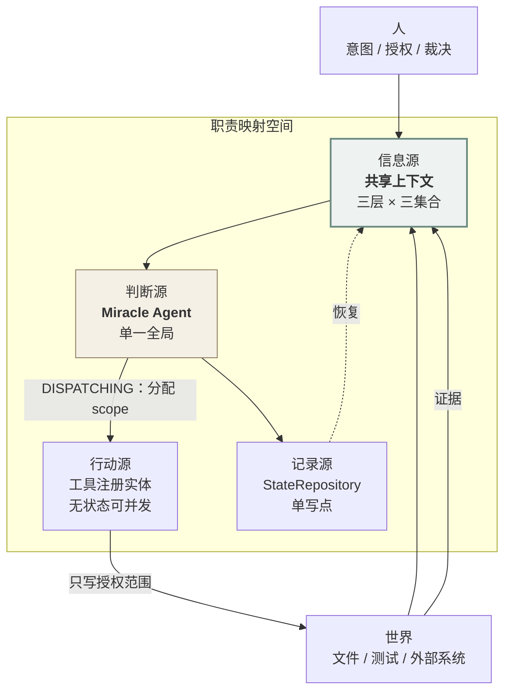

# Direction: shared-context

> Status: **ACTIVE** · Weight: critical path（决定 M2 之后的架构走向；但它自己的第一个切片**不在** MVP 关键路径上）
> Opened: 2026-10-28 · 来源：作者 2026-10-27 的架构判断（原文见 §0）
> 可信度：**提案层（不可信）**。未通过晋升门之前，任何实现不得引用它作为依据。

---

## 0. 原始主张（作者的表述，不改写）

> 1. WAM 不使用传统的 Multi-Agent 路径。理由：WAM 更偏向于长线聚合性的科研任务。Multi Agent 目前存在巨大的调度问题（即使在 cache to cache 的架构下，信息交换的意义也不是很大）。
> 2. WAM 应使用特制的共享上下文，这会作为一个单独组件（多层级且拥有各个 agent 的显性探索边界），这个组件就位于"信息源"的职责映射空间内。
> 3. WAM 在默认的调度模式下只会启用 Miracle Agent（也就是全局 Agent），他拥有同时调用多个工具注册实体的权限。
> 4. 需要决定加入多少交互表征（如将 Agent State 映射为用户所查看到的有限状态机，如调研中、脑暴中、调度中）。

第 4 条已按 `docs/development/scope.md` U1 与 `docs/architecture.md` §12 处置（**进 MVP 最小版**）。本方向只承载第 1–3 条。

---

## 1. 假设（一句话）

> **WAM 的协作基座不是 agent 之间的消息，而是一个分层的、带显式探索边界的共享上下文；默认只有一个全局 Agent 写它，多 Agent 只有在该上下文的 scope 机制被证明有效之后才被允许接入。**

三个可分开检验的子假设：

| # | 子假设 | 是否已验 |
|---|---|---|
| **H-a** | agent 之间的**消息**不是有效的协调方式（对长线聚合任务） | 有外部支持（`research/external-assets.md` A1/A2），但**不是受控实验** |
| **H-b** | 共享上下文作为**独立组件**（而非附属数据结构）能降低状态失同步 | **未验**，本方向的核⼼ |
| **H-c** | 「默认单 Agent + 并发调多工具」在能力上**不弱于**多 Agent 编排 | **未验**，且与 Anthropic 的广搜报告存在张力 |

---

## 2. 证伪条件（三条，任一成立即归档）

| # | 证伪条件 | 怎么观察 |
|---|---|---|
| **F-1** | scope 字段加了，但**从未被任何代码读取过** | 3 个月后 grep：`scope` 只出现在 schema 与写入处，没有读取分支 → 它是装饰，删掉 |
| **F-2** | 在**真正可并行**的任务上（≥2 个独立只读子问题），单 Agent 顺序执行的耗时/质量**不差于**并发 | 一次对照实验（W8 之后可做） |
| **F-3** | 维护 scope 的成本 > 它避免的冲突数 | 记录每一次因 scope 而阻塞的执行；若 10 次里 ≥9 次是误报，则规则错了 |

**F-1 是这三条里最可能发生的**，也是本方向最大的风险：一个没人读的字段，和没有这个字段是一样的——只是多了一层"我们已经考虑过并发"的自我安慰。

---

## 3. 职责映射空间：四个源

作者说"这个组件就位于**信息源**的职责映射空间内"。把它形式化，WAM 的职责分成四个源，**每个源有唯一的所有者**：

| 源 | 回答什么 | 唯一所有者 | 对应五概念 | 谁能写 |
|---|---|---|---|---|
| **信息源** Information Source | 世界是什么样、我们以为它是什么样 | **共享上下文**（本方向） | Situation / Evidence | 工具、观察、人；**所有 agent 只经由此处了解世界** |
| **判断源** Judgment Source | 什么重要、下一步什么类型 | **单一全局 Agent（Miracle Agent）** | Judgment | 只有它 |
| **行动源** Action Source | 谁去改变世界 | 工具注册实体（无状态、可并发） | Move / Execution | 只有被授权的实体 |
| **记录源** Record Source | 谁拥有状态、如何持久 | `StateRepository`（单写点） | Persistent Record | 只有循环本身 |

**这个划分解释了"为什么不是多 Agent"**：多 Agent 架构的失败不在"agent 太多"，在**四个源的所有者被复制了**——多个判断源会争仲裁，多个信息源会产生互相矛盾的"事实"。`research/external-assets.md` A2 的 3 类失败模式，全部落在这个框架里：

| MAST 失败类别 | 对应的源被复制 |
|---|---|
| 系统设计问题 | 记录源（没有单一状态所有者） |
| agent 间失配 | 判断源（多个仲裁者）+ 信息源（各自的局部视角） |
| 任务验证 | 信息源（没有外部接地的证据） |

**所以本方向的立场可以一句话概括**：

> **WAM 要黑板的"板"（共享的信息源），不要黑板的"主席"（仲裁性的控制源）。**

（黑板三部件与这一取舍的对应见 `research/external-assets.md` §2.B。）

---

## 4. 共享上下文的结构：三层 × 三个集合

### 4.1 三层

| 层 | 范围 | 生命周期 | 例 |
|---|---|---|---|
| **L-项目** Project | 整个项目 | 跨会话，永久 | "这个项目的目标是用 1% 的底座解决状态失同步" |
| **L-移动** Move | 一个 Active Move | 该 Move 一生 | "本次 Move 只改 lockfile，不动业务代码" |
| **L-作用域** Agent | 一个执行实体 | 一次调用 | "这个实体只读 `tests/`，不得写" |

**三层的必要性**：只有项目层 → 无法约束单次执行；只有作用域层 → 每次调用都要重建上下文，失去连续性；三层都有 → 上层是下层的默认值，下层可以**收窄但不能扩张**（这是关键的不变量）。

### 4.2 三个集合（显性探索边界）

每个执行实体在 `DISPATCHING`（`docs/architecture.md` §12.3 状态 3）时被分配：

```jsonc
"scopes": {
  "read":     ["src/**", "tests/**", "docs/**"],
  "write":    ["src/parser.py"],          // 写集必须显式；空写集 = 只读实体
  "forbidden":["~", ".git", ".ssh", ".env", "outside_project_root"]
}
```

| 规则 | 内容 |
|---|---|
| **收窄不变式** | 子作用域 ⊆ 父作用域。任何扩张请求必须回到 `DISPATCHING` 并重新过授权判定 |
| **写集不相交** | 并发的两个实体，`write` 集合必须不相交；相交则**阻塞**，不静默串行化（静默串行化会隐藏设计错误） |
| **读集可相交** | 读不相交没有意义，且会制造无谓的等待 |
| **forbidden 是全局继承的** | 任何层都不能把 `forbidden` 里的东西加回来 |

### 4.3 为什么"显式"很重要

隐式边界（"你大概只改这个文件"）在单 agent 下是可接受的，因为失败会被下一次判断看到。但在多实体下，**隐式边界会让冲突发生在提交时而不是执行时**——那时已经产生了半成品状态。

`docs/development/scope.md` U6 的定位正是：**MVP 只带字段（默认 `project` + 空 `forbidden`），不带服务。** 字段的成本是 1 行，服务（分配器、冲突检测、锁）的成本是数周。

---

## 5. 默认调度：Miracle Agent + 工具并发

| 项 | 内容 |
|---|---|
| **默认** | 只有 1 个全局 Agent（Miracle Agent）。它持有判断源，可**同时**调用多个工具注册实体 |
| **工具注册实体** | 无状态、幂等、有显式 scope；（对应黑板的 knowledge source） |
| **并发许可** | 同一次 `DISPATCHING` 内，写集不相交的实体可并发（`docs/development/scope.md` M5） |
| **窄例外**（唯一的破例） | 子任务**同时**满足：① 彼此独立 ② 只读 ③ 结果可被主 Agent 独立复核。三条件缺一不许并发（依据：`research/external-assets.md` A3 的收益依赖的正是这个任务形状） |
| **明确不做** | 不让多个 agent 互相"讨论"以达成一致。依据 A1 原则 2：分歧不会因多轮对话收敛，只会消耗上下文 |

**这一节与 `docs/development/scope.md` M6（= G5 拒绝）的关系**：拒绝的是**"agent 间对话式调度"**，不是"并发"。这个区分必须在文字上守住，否则本方向会被读成"又要做多 agent 了"。

---

## 6. 最小证伪实验（一个会话，不写产品代码）

> **局部性结论**：单一全局 Agent 下的并发工具调用，能否在**不引入共享上下文服务**的情况下，被规则可靠地检测出写集冲突？

| 阶段 | 做什么 | DoD |
|---|---|---|
| 1 | 在 fixture 项目上让 1 个 Agent 并发发起 2 个写操作，`write` 集**不相交** | 两者都成功，`journal` 有两条独立记录，状态无覆盖 |
| 2 | 同上，但 `write` 集**相交**（都写同一文件） | **阻塞并报告冲突**；不得出现"后写覆盖先写"且无记录 |
| 3 | 同上，但一个实体的 `write` 试图越过父作用域 | 拒绝，且回到 `DISPATCHING`，产生一条 `ASKING` 或 `Blocked` |

**通过判据**：阶段 2 的冲突被检出——**而不是靠"两个 agent 恰好没打架"**。
**失败判据**：阶段 2 静默通过 → 说明 scope 机制在实际执行路径上不存在，H-b 被削弱，F-1 提前命中。

**成本**：一个会话。**依赖**：需要一个能并发调工具的执行器（`docs/development/roadmap.md` §4 D1 的 A 或 C）。

---

## 7. 架构图



**读法**：两个入口（世界、人）都只进**信息源**；只有判断源能分配行动；只有行动源能改变世界；只有记录源能持久。**四个源各只有一个所有者，这就是"默认单 Agent"的准确含义**——不是"只有一个进程"，而是"判断源没有被复制"。

---

## 8. 与已有四个方向的关系

| 方向 | 关系 |
|---|---|
| `global-route/` | **最近的邻居**。两者都主张"单一全局编排实体"。区别：global-route 的重心是**跨会话续接**（反向机、新进程），本方向的重心是**并发下的信息边界**。若两者都通过晋升门，应当合并为一个方向而不是并存 |
| `substrate/` | **可实现的部分在它那里**。共享上下文的持久化就是 `wam` CLI 的 `state check`；本方向不新建存储，只加 scope 语义 |
| `agent-plugin/` | **冲突**。把 WAM 嵌进宿主 agent 时，scope 由谁分配？本方向主张：仍由 WAM 分配，宿主只执行。这一条若无法成立，agent-plugin 与 shared-context 互斥 |
| `weight-first/` | **无关**。权重是判断源的输入，本方向不碰它 |

---

## 9. 晋升门（`directions/README.md` 的标准四条件）

1. `workspace/decisions.md` 记一条带理由与替代方案的决策；
2. 引用证据：§6 实验的 `results.md` 路径 + 阶段 2 的冲突检出输出；
3. 产物迁入官方位置：`scope` 语义 → `docs/specifications/state-and-evidence.md`；状态机与 `DISPATCHING` 的关联 → 已在 `docs/architecture.md` §12；服务实现（若有）→ 代码树；
4. 本目录移入 `directions/archive/`。

**未过门时**：不改动 `docs/` 中任何关于"多 agent"的表述。`docs/development/scope.md` M6 保持 G5（拒绝）。

---

## 10. 明确不做

| 不做 | 理由 |
|---|---|
| 消息总线 / agent 间消息队列 | 那正是 H-a 要否定的东西。做了它，本方向就变成了它反对的东西 |
| 仲裁器 / 调度器服务 | 判断源必须唯一。仲裁器就是第二个判断源 |
| 共享上下文的服务端（锁、事务、合并） | MVP 只有 1 个 agent；服务要在第二个真实 agent 出现后才建 |
| 向量检索作为上下文检索方式 | 已在反借鉴清单（`reference/WORKFLOW.md`）：检索漏检 + 陈旧，且人不可读 |
| 统一的"全局黑板"对象 | 三层结构已经足够。一个全局对象会让 scope 变成注释 |

---

## 11. Work log

- 2026-10-28: 由作者 2026-10-27 的三条判断建立。第 1 条（不用传统多 agent）与第 3 条（默认单 Agent + 工具并发）已有外部支持（`research/external-assets.md` A1/A2）；第 2 条（共享上下文作为独立组件）**尚无外部核实**——最近的两篇先例（SE-Blackboard、LLM 黑板）在本会话未读到全文，**因此不能声称原创**。已登记到 `research/external-assets.md` §2.B 的待读清单。
- 2026-10-28: 第 4 条（交互表征数量）已按 `docs/architecture.md` §12 处置为 10 状态 / 6 模式，并在 `docs/development/scope.md` 记为 U1（MVP-MIN）。

## 12. Next step

一个会话的 §6 实验（三阶段，DoD 已写定）。**在此之前不要写任何 scope 相关的产品代码**——`docs/development/scope.md` U6 只要求字段进 schema，字段已经够了。

**先读后做**：`research/external-assets.md` §4 的第 2 项（SE-Blackboard）必须在写实验报告之前读完。否则我们可能在"发现"别人三年前就发表过的东西。
