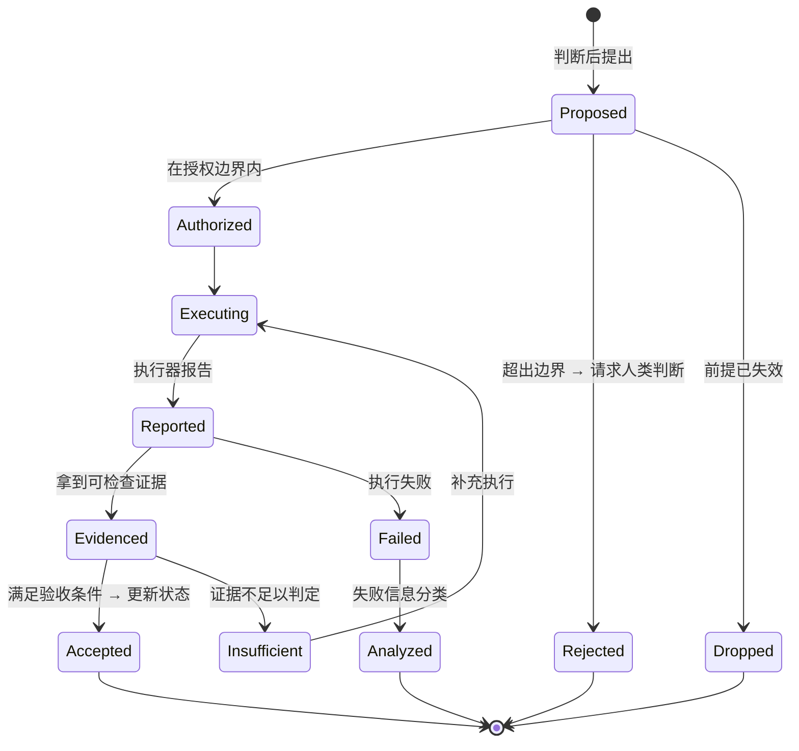

# State, Move & Evidence Model — 状态、行动与证据模型

> 版本：2026-10-09 · 状态：**Current Design Baseline**（职责已定，字段未细化）
> 依赖：`docs/03-vision-and-concepts.md` · `docs/04-architecture.md`
> 决策记录：`docs/07-decision-register.md`

---

## 0. 细化边界

本文档只细化**正式开发所必需**的内容：每个概念必须能表达什么、谁在什么时候更新、什么条件下允许更新。

**不**设计所有可能字段和抽象。需要更细的字段集时，在 MVP 暴露真实问题后再定（1% 原则）。

---

## 1. Situation 需要表达什么

Situation 是**当前判断的依据**。它必须同时容纳"已知的"和"不知道的"，并区分两者。

### 1.1 必备内容

| 内容 | 说明 | 现有载体 |
|---|---|---|
| **已知事实** | 有来源、可核验 | `state.md` Known |
| **假设** | 待验证，但当前被当作前提使用 | ⚠️ 未与 Unknown 分离 |
| **未知** | 明确不知道，且知道它在哪 | `state.md` Unknown |
| **未知-未知** | 连"不知道什么"都还不知道 | `state.md` Unknown-Unknowns |
| **依赖** | 阻塞当前推进的外部条件 | ⚠️ 无结构 |
| **资源约束** | 时间、算力、预算 | ⚠️ 分散（`goals.md` 里零散提到 "next session"） |
| **不可逆风险项** | 做错了不能撤回的东西 | ❌ 缺 |
| **人类介入条件** | 什么情况下必须停下来问人 | ❌ 缺 |
| **过往行动及其结果** | 做过什么，实际发生了什么 | ⚠️ 在 `log.md`，但不在局面里 |

### 1.2 Situation 不是历史摘要

**判定标准**：Situation 的内容应当是"当前判断需要的"，不是"发生过什么"。

`log.md` 是历史，`state.md` 是局面。两者可以重复，但职责不同：

- `log.md` 回答"我们做过什么"
- `state.md` 回答"现在是什么局面"

**当两者冲突时（log 里有最新进展但 state.md 未更新），以 state.md 未更新为准——这说明局面尚未更新，判断的依据仍应是旧局面。** 这正是"跨会话恢复不依赖长对话摘要"的原因：摘要是 log 的投影，state 是权威。

---

## 2. 事实、假设、未知、决策、证据的区分

这是 WAM 认识论状态的核心（`docs/03-vision-and-concepts.md` §5 的 Knowledge 维度）。

### 2.1 五类的定义与判据

| 类型 | 定义 | 判据 | 现有载体 | MVP 载体 |
|---|---|---|---|---|
| **事实 Fact** | 现实如此，可独立核验 | 能指出来源，能被他人按同样方式复核 | `state.md` Known | `situation.facts[]`（`source` 必填） |
| **推导 Inference** | 由事实按逻辑得出 | 推理链可写出，前提可指出 | ❌ 无专门标记 | `judgment.why`（明确标为判断的一部分，**不进 facts**） |
| **假设 Assumption** | 当前当作前提，尚未验证 | **能说出如何验证**；说不出验证路径的，不是假设，是信仰 | ❌ 缺（`state.md` Unknown 中混在一起） | `situation.assumptions[]`（`validation_method` 必填，缺失则 `status=belief`） |
| **未知 Unknown** | 明确不知道，且知道它在哪 | 能写出"要回答它需要什么" | `state.md` Unknown | `situation.unknowns[]`（`blocking` 必填） |
| **不可观测 Unobservable** | 原理上无法确定 | — | ❌ 缺 | MVP 仍不建模（承认不足，而非假装） |

### 2.2 决策与证据不是状态，是过程产物

| 类型 | 性质 | 载体 |
|---|---|---|
| **决策 Decision** | 判断的**结果**（做了什么判断），含理由、依据、排除了什么 | `decisions.md` |
| **证据 Evidence** | 现实中**实际发生**了什么 | `log.md` Evidence 字段 |

### 2.3 防止假设被当成事实

**这是 Open Question OQ-03，不是已解决问题。** 现有机制只有语言层面的约定（`docs/01-foundation.md` 硬规则 4：unknown-unknowns 必须明确列出），没有结构保障。

已知的部分缓解手段（均在设计中，非实现）：

1. Situation 中假设与事实分区存放，不混在同一列表。
2. 每个假设必须附带验证路径，否则降级为信念并标注。
3. Evidence 更新状态时，只允许把"已被证据检验的假设"升级为事实。
4. 晋升需要显式动作，不是"沉默即正确"。

**当前仓库未实现任何一条。**

**MVP 的结构化落地**（`docs/06-development-plan.md` §6.3）——把上述四条变成 schema 级约束：

| 约束 | 实现形式 |
|---|---|
| 事实必须有来源 | `facts[].source` 为**必填**，无 source 拒绝入库 |
| 假设必须有验证路径 | `assumptions[].validation_method` 必填；缺失则 `status` 只能是 `belief` |
| 分区存放 | `facts[]` / `assumptions[]` / `unknowns[]` 是三个独立数组 |
| 晋升需显式动作 | 假设升级为 fact 必须显式动作 + 证据引用；**时间流逝不触发任何自动升级**（验收 A12） |

**这仍是防护，不是解决方案。** 它挡不住"模型把推断写进 `source` 字段"。判断这一层是否有效，属于 Phase 4 的检验范围。

### 2.4 认识论状态与 research 的对应

`docs/research/03-unknown-and-weight.md` 已记录：

- Smithson 1989 的四象限（known / known-unknown / unknown-unknown）正是 `state.md` 三段所用的词汇。
- **无监督的 unknown-unknown 检测本质上是未解问题**（该文献明确标注）。

因此 WAM 在这方面的贡献定位必须诚实：

> **WAM 的贡献是显式登记 + 人在回路，不是自动检测。** 声称能自动发现 unknown-unknown 会是不诚实的表述。

---

## 3. Move 的职责与生命周期

### 3.1 Move 的四个必备要素

| 要素 | 内容 | 为什么必须 |
|---|---|---|
| **意图** | 这个 Move 服务于 Intent 的哪一部分 | 无此则 Move 可能与目标无关，甚至破坏目标（验收 T7） |
| **前提** | 它依赖哪些假设与条件 | 前提失效则 Move 结果不可解释 |
| **预期改变** | 做完之后什么会不同 | 无此则无法判断 Move 是否成功，只能靠"看起来做完了" |
| **如何确认** | 验收方式 | 对应 `docs/04-architecture.md` §5 的第 4 级 |

### 3.2 生命周期

> **本表是完整状态集，权威定义在此。** MVP 激活的状态子集、与本表的映射、以及工程约束（幂等键、权限边界、原子写入）见 [`docs/06-development-plan.md` §7](06-development-plan.md)。

### 3.3 关键规则

| 规则 | 说明 |
|---|---|
| **执行与验证分离** | Move 自己不宣布完成。执行器说"成功"只是 `Reported` |
| **未满足验收 ≠ 失败** | 是 `Insufficient`，需要补证据，不是重做 |
| **失败必须分析** | 进入 `Analyzed`，产出信息而非仅报错（见 §5） |
| **不可逆 Move 需显式授权** | 超出授权边界 → `Rejected`，转人类判断节点 |
| **Active Move 治理** | 同时可以只有一个处于 `Authorized`/`Executing` 的 Move；但一个 Move 内部可并行（`docs/03-vision-and-concepts.md` §4.4） |

### 3.4 现状差距

现有 `goals.md` 条目格式：`- [ ] Title — Weight: critical path — Progress — Next step`。实验模板 `experiments/_template/stages/01-example-stage/plan.md` 有 Goal / DoD / Plan / Falsification note 四段。

**已具备**：目标、DoD（≈验收）、时间盒（部分）。
**缺失**：前提依赖、预期改变（与 DoD 部分重叠但不同）、状态机位置、失败分析结果。

### 3.5 MVP 如何落地这四要素

MVP 的具体字段（`.wam/state.json` 的 `active_move`）见 [`docs/06-development-plan.md` §6.2](06-development-plan.md)。四要素的对应：

| 本节要素 | `active_move` 字段 | MVP 强制程度 |
|---|---|---|
| 意图 | `intent_ref`（指向 `goals[].id`） | **必填**，缺失则停在 `Proposed` |
| 前提 | `premises[]`（引用 `assumptions`/`facts` 的 id） | **必填且非空** |
| 预期改变 | `expected_change` | **必填** |
| 如何确认 | `acceptance[]`（在 Move 被接受时即写定并持久化） | **必填且非空**；事后补的验收条件等于没有 |
| 判断理由 | `why` | **必填**；`docs/06` §9.2 A10 会自动检查它是否引用了具体 fact id |
| 幂等 | `idempotency_key`（**禁止含时间戳**） | **必填**；中断恢复的唯一依据 |
| 可逆性 | `reversible` | **必填**；`false` 时中断后禁止自动重试 |

---

## 4. 执行、验证与状态提交的关系

三个动作必须分开，不能合并：

| 动作 | 主体 | 产出 | 失败时 |
|---|---|---|---|
| **执行 Execute** | 执行层 | 动作已发生 | 记录失败，进入失败分析 |
| **验证 Verify** | WAM 基于证据 | 证据满足 / 不满足验收条件 | 记为 `Insufficient`，不伪造 |
| **提交 Commit** | WAM | 项目状态正式更新 | 不提交，保留旧状态 |

**"验证行动是否成功"与"判断行动是否值得"是两个不同的问题**（`docs/03-vision-and-concepts.md` §4.5）。

- 验证：这次 Move 达成了预期改变吗？→ 可由证据回答。
- 判断：这次 Move 值得做吗、做完是否还要继续？→ 需要 Judgment，且可能因为"做成了"而得出"这条路到此为止"的结论。

一个成功的 Move 完全可能导致"停止当前方向"。这两件事不冲突。

---

## 5. 失败与否定证据

### 5.1 失败的信息价值

失败不是"任务失败"，是**信息**。它可能：

| 失败揭示 | 对后续的影响 |
|---|---|
| 新约束 | Situation 的约束集增加 |
| 否定某个假设 | 该假设从"待验证"变为"已被推翻" |
| 缩小可行方案空间 | 可能方案列表收缩，Judgment 的选择变少 |
| 工具或环境不可靠 | 后续 Move 的执行策略需调整 |
| 证明某条路径不值得继续 | 该方向归档（`directions/` 的归档机制正是为此存在） |

### 5.2 必须防住的失效

**失效模式：重复无效行动。** 系统在同一路径上失败、改参数、再试、再失败——因为失败信息没有进入 Situation，Judgment 的输入没变。

**防范机制（设计基线）**：失败必须写入记录，且**必须改变后续 Situation 或 Judgment 的输入**。若一个失败不影响任何判断，它就不是被正确处理的失败。

### 5.3 现状

- ✅ `experiments/README.md` 硬规则 3：results.md 必须记录失败项，不隐藏。
- ✅ `directions/` 归档机制记录失败方向（"归档是记忆，不是羞辱"）。
- ❌ **没有机制把失败与"哪条假设被否定"关联起来。** 这是 `docs/06-development-plan.md` 的 MVP 目标之一。

---

## 6. 关键状态如何跨会话恢复

### 6.1 恢复的判据

新会话开始时，仅凭持久记录应能回答：

1. 我们试图实现什么？（Intent）
2. 现在是什么局面？（Situation）
3. 已经确认了什么？（事实与证据）
4. 哪些还不知道？（未知）
5. 哪些是假设、凭什么信它？（假设与验证路径）
6. 做过哪些决定、为什么？（决策记录）
7. 上一步做到哪、结果如何？（Move 状态 + 结果）
8. 产物在哪？（可追溯路径）
9. 什么走不通？（失败路径与否定证据）
10. 下一步为什么值得做？（方向 + 理由）

### 6.2 现有恢复能力核对

> 核对时间 2026-10-09。**"能否回答"一列针对的是本仓库当前状态（`workspace/*.md`），不是 MVP 计划中的能力。**

| # | 问题 | 现有载体 | 能否回答 |
|---|---|---|---|
| 1 | 试图实现什么 | `idea.md` / `README.md` | ⚠️ 项目层面能；**会话级意图与授权不能** |
| 2 | 现在什么局面 | `state.md` | ✅ |
| 3 | 确认了什么 | `state.md` Known + `log.md` | ✅ |
| 4 | 哪些不知道 | `state.md` Unknown | ✅ |
| 5 | 假设及其依据 | — | ❌ **无法** |
| 6 | 决策与理由 | `decisions.md` | ✅ |
| 7 | 上一步到哪 | `goals.md` + `log.md` | ✅ |
| 8 | 产物在哪 | `log.md` Evidence | ✅ |
| 9 | 什么走不通 | — | ❌ **无法** |
| 10 | 下一步为何值得 | `goals.md` Next step | ⚠️ 有 Next step，但"为什么值得"缺 |

**6 项可答，2 项不可答，2 项勉强。** 缺口集中在 **假设**（5）与 **失败路径**（9）。

**MVP 的目标状态**（`docs/06-development-plan.md` §6.4）：把第 5 项和第 9 项变成可答。

| # | 问题 | MVP 载体 |
|---|---|---|
| 5 | 假设及其依据 | `situation.assumptions[].{statement, validation_method, status}` |
| 9 | 什么走不通 | `history[].{expected_change, verdict, refuted_assumptions}` + `journal/` |
| 10 | 下一步为何值得 | `journal[].summary` + `active_move.why` |

第 1 项（会话级意图）在 MVP 中同样解决：`intent.raw` 保存用户原话，`intent.authorization` 保存授权边界。

### 6.4 MVP 的恢复判据

MVP 只需回答**五个问题**（`docs/08` 的 T2、T5）：

1. 上一个 Move 是什么状态？
2. 它如果停在 `executing`，能否安全重试？（看 `idempotency_key` + `reversible`）
3. 当前 Situation 是什么？
4. 已确认的事实与尚未验证的假设分别是什么？
5. 上次更新状态的结果是什么？

**这五问不需要对话摘要，不需要读 git 历史，不需要人工回忆。**

### 6.3 不依赖长对话摘要

原则：**跨会话恢复只能依赖持久记录，不能依赖对话摘要**。

摘要的问题：它是投影，会丢信息、无法核验、随长度截断。摘要可以作为派生视图（给人快速阅读），但不能是权威来源。

对应到设计：`log.md`（历史，append-only）+ `state.md`（当前局面，权威）+ `decisions.md`（判断留痕）+ git（版本与 diff）构成持久记录；任何摘要都是这四者的投影。

---

## 7. 状态膨胀的控制

**Open Question OQ-06：如何避免项目状态无限膨胀。**

已知风险与现有信号：

| 风险 | 现有证据 |
|---|---|
| `log.md` 无限增长 | 已发生：`log.md` 27 条长条目，最长一条数百字 |
| 原始轨迹塞进上下文会退化 | ADAMEM 的 verbosity pathology（`reference/enhancement/adamem.md`）：检索轨迹数 k 增大时性能从 52.1% 降到 47.8% |
| 现有对策 | ADAMEM 建议已采纳为设计准则：`wam goal next` 输出**一行**，不是一页 |

**MVP 阶段的策略**（不新建机制）：

1. 读的时候不全读——`log.md` 只读尾部（`docs/01-foundation.md` 六步协议 Read 步已规定）。
2. 写的时候要短——每条 log 回答"发生了什么 + 证据"，不复述过程。
3. 状态文件（`state.md`/`goals.md`/`decisions.md`）保持精简，历史沉到 `log.md` 和 git。

**不做**自动摘要、压缩、遗忘机制。`docs/research/02-memory-and-state.md` 明确："LLM-generated reflections/summaries have no correctness guarantee"。在没有正确性保证前自动压缩状态，是把不确定性引入权威来源。

---

## 8. 相关文档

| 需要 | 去看 |
|---|---|
| 概念定义 | `docs/03-vision-and-concepts.md` |
| 循环与组件职责 | `docs/04-architecture.md` |
| 实现顺序 | `docs/06-development-plan.md` |
| 开放问题 | `docs/07-decision-register.md` |
