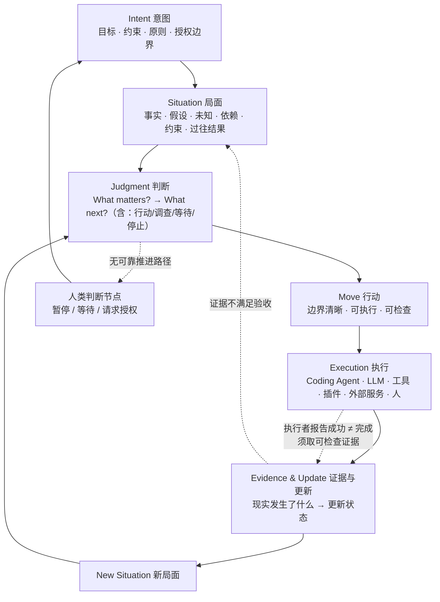
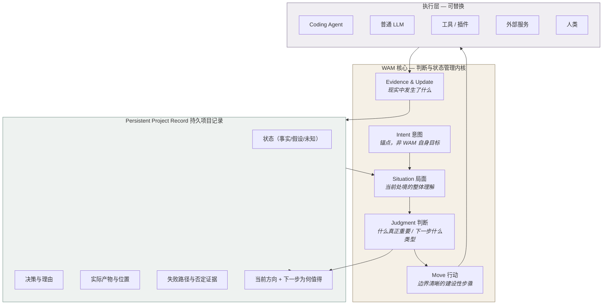
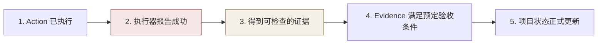
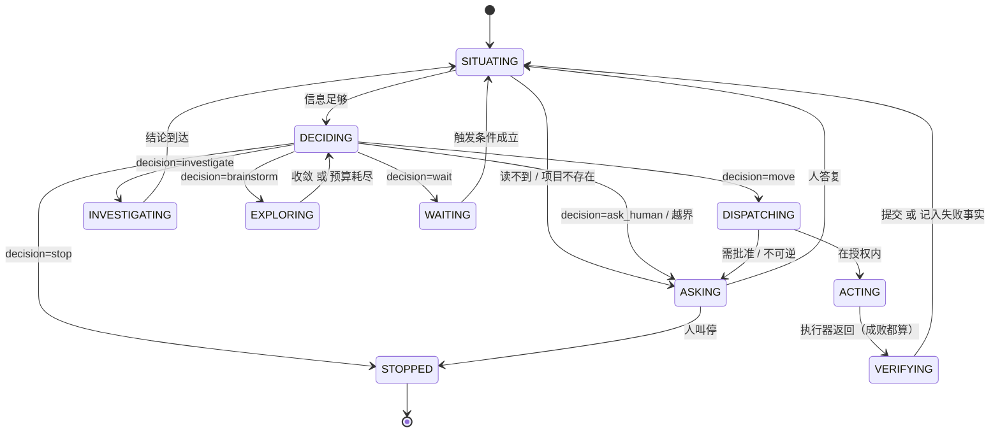

# Architecture — 架构

> 版本：2026-10-09 · 状态：**Current Design Baseline**（概念设计，尚未实现）
> 依赖：`docs/vision.md`（概念定义）· `docs/specifications/state-and-evidence.md`（数据结构职责）
> 决策记录：`docs/decisions/register.md`

---

## 1. 本文档的边界

本文档说明**核心循环、组件职责、信息流、状态角色、执行层边界**。

它**不**规定：类名、模块目录、编程语言、框架、Agent 数量、模型供应商、运行时形态。这些都是实现选择（`docs/vision.md` P7）。

**当前仓库的实现状态：零代码。** 本文档描述的是目标架构，不是对现有代码的描述。唯一存在的实现是 `workspace/` 四文件的 Markdown 状态模型（人工读写），见 §7。

---

## 2. 核心循环



**这个循环与 `docs/foundation.md` 六步协议的对应关系**：

| 本文档循环 | 六步协议 | 变化 |
|---|---|---|
| Intent + Situation | **Read** | 明确 Intent 需要被读，而不只是目标和进展 |
| Situation → Judgment 前 | **Wait** | 「Wait」不只是停顿，是判断"是否真的理解局面" |
| Judgment | **Judge** | 从"最高权重的一步"扩展为"什么类型的一步"（含等待/停止） |
| Move | **Do** | 从"取一步可验证的行动"明确为有边界的治理单位 |
| Evidence & Update | **Verify** + **Write** | 明确区分"验证行动成功"与"判断行动值得"；明确区分"拿到证据"与"证据满足验收条件" |

**六步协议仍然有效**，本文档是对它的细化与修正，不是替换。

---

## 3. 概念架构图



**读法**：WAM 核心**拥有**项目状态；执行层**借用**它。执行层可以整体替换（换 Coding Agent、换模型、换工具），项目状态不随之丢失。这是设计原则 P4 的图形表达。

---

## 4. 组件职责与信息流

### 4.1 Intent（意图）

| 项 | 内容 |
|---|---|
| **职责** | 保持"哪些目标、约束、原则、授权边界需要持续有效" |
| **输入** | 用户明确表达；用户修订 |
| **输出** | 判断的锚点；Move 的方向来源；越界判定标准 |
| **不负责** | 不判断当前什么重要（那是 Judgment）；不描述现状 |
| **关键约束** | WAM 可以解释、澄清、建议，**不能自行改写用户的根本目标** |
| **现状** | ⚠️ **无持久载体** — 见 `docs/vision.md` §7 |

### 4.2 Situation（局面）

| 项 | 内容 |
|---|---|
| **职责** | 维护"当前判断的依据" |
| **输入** | 项目状态、外部现实、已有事实、未知、假设、依赖、资源、时间约束、过往行动及结果 |
| **输出** | 供 Judgment 使用的整体理解；New Situation 是循环的输出 |
| **不负责** | 不是聊天记录、不是历史摘要、不是静态 Task List |
| **关键约束** | 随新观察和新证据持续更新；区分事实与推断（`docs/specifications/state-and-evidence.md`） |
| **现状** | ✅ `workspace/state.md` 已有 Known / Unknown / Unknown-Unknowns 三段基线 |

### 4.3 Judgment（判断）

| 项 | 内容 |
|---|---|
| **职责** | 回答 What matters?，再回答 What next? |
| **输入** | Intent + Situation + （可选）weight tier、关键路径计算、启发式维度观察 |
| **输出** | 一个有理由的判断：做什么 / 调查什么 / 等待 / 停止 / 请求人类判断 |
| **不负责** | 不是 Planner 的同义词，不是优先级排序算法，不是 Wisdom Engine Prompt |
| **关键约束** | 必须可追溯（能回答"你为什么认为这个重要"）；必须包含"不行动"这个选项 |
| **现状** | ⚠️ 只有**事后记录**（`workspace/decisions.md`），无判断过程载体 |

**输出类型**（Judgment 必须至少能产出这些，而不只是"下一步做什么"）：

| 类型 | 何时选它 |
|---|---|
| 执行 Move | 证据充分、方向明确、可验证 |
| 先调查 | 关键未知阻碍判断，调查成本低于行动风险 |
| 等待 | 信息需外部时间成熟，或环境未准备好 |
| 缩小范围 | 全量推进成本超出可承受 |
| 改变路径 | 原路径已被证据削弱 |
| 停止 | 该路径不值得继续 |
| 请求人类判断 | 超出授权边界，或不可逆/高风险 |

这张表是设计原则 **P5（不要默认行动总是优于等待）** 的直接落实。

### 4.4 Move（行动）

| 项 | 内容 |
|---|---|
| **职责** | 把判断转化为边界清晰、可执行、可检查的建设性步骤 |
| **必备四要素** | 意图（服务于哪个 Intent 的一部分）、前提（依赖什么假设）、预期改变（做完什么会不同）、如何确认（验收方式） |
| **生命周期** | 提出 → 执行 → 收集证据 → 判定（满足验收/未满足）→ 更新状态 |
| **不负责** | 不自带验证逻辑（验证是 Evidence 的职责） |
| **治理约定** | 以一个明确的 Active Move 作为推进与状态提交的基本治理单位 |
| **现状** | ⚠️ 部分载体：`goals.md` 单条目 + `experiments/_template/stages/*/plan.md` |

**关于"一个 Active Move"的边界**（防过度约束）：

- ❌ 不意味着一次只能调一个工具
- ❌ 不意味着只能有一个 Agent
- ❌ 不意味着一切操作机械串行
- ✅ 并行与否由**该 Move 的边界、依赖和风险**决定

### 4.5 Evidence & Update（证据与更新）

| 项 | 内容 |
|---|---|
| **职责** | 判断现实中实际发生了什么，据此更新状态与局面理解 |
| **输入** | 测试结果、实际产物、实验记录、外部系统响应、官方评分、用户反馈 |
| **输出** | 可检查的证据；状态更新建议；失败信息 |
| **不负责** | 不等于"执行器报告成功" |
| **现状** | ✅ `workspace/log.md` 的 `Evidence:` 字段有部分载体 |

---

## 5. 五级证据阶梯

这是本架构最重要的操作性区分。必须逐级确认，**不得跳级**：



| 级别 | 谁说的 | 可信度 |
|---|---|---|
| 1. Action 已执行 | 执行器 | 低（可能只启动了） |
| 2. 执行器报告成功 | 执行器 | **低——这是最常见的误判来源** |
| 3. 得到可检查的证据 | 现实 | 高 |
| 4. 满足预定验收条件 | WAM + 验收条件 | 高（前提是验收条件事先写定） |
| 5. 状态正式更新 | WAM | 需 1–4 全部成立 |

**2 → 3 的跨越是 Evidence 的核心价值。** 设计原则 P4 与场景验收 T3（执行器报告成功但产物不支持）都针对这一级。

### 5.1 失败也必须形成信息

失败不能简单归类为"任务失败"。失败可能是：

- 暴露新约束
- 否定某个假设
- 缩小可行方案空间
- 揭示工具或环境的不可靠性
- 证明某条路径不值得继续

**这些信息必须写入记录并影响后续 Situation 和 Judgment，防止系统重复无效行动。** 这是 `workspace/log.md` 之外必须补的能力（见 `docs/development/mvp-plan.md` §6）。

---

## 6. 概念 vs 代码模块

**这是本文档最容易被误读的一节。**

| 概念 | 是否必然是一个模块 | 可能的存在形式 |
|---|---|---|
| Intent | **否** | 可能是状态文件的一个区块、一段结构化文本、或独立存储 |
| Situation | 否 | 可能是派生视图而非持久实体 |
| Judgment | 否 | 可能是一次 LLM 调用 + 一段结构化输出 |
| Move | **可能是** | 需要生命周期跟踪，最接近"实体" |
| Evidence | **可能是** | 需要可追溯引用与验收判定 |
| Persistent Record | **是** | 这是唯一必须持久化的东西 |

**判断规则**：先定职责和交互关系，再决定代码模块（设计原则 P7）。任何把五个概念直接画成五个类的设计文档，都应被质疑。

---

## 7. 现有仓库映射

**这一节区分"已存在"与"仅设计"。这是防幻觉的关键。**

### 7.1 已存在（可用证据核对）

| 架构要素 | 现有载体 | 证据 |
|---|---|---|
| Intent（部分） | `idea.md`、`README.md` 的愿景表述 | 文件存在，但**无会话级授权记录** |
| Situation | `workspace/state.md`（Known / Unknown / Unknown-Unknowns） | 文件存在，结构已用 |
| Move | `workspace/goals.md` 条目 + `experiments/_template/stages/*/plan.md` | 文件存在，字段不足 |
| Evidence | `workspace/log.md` 的 `Evidence:` 字段 | 文件存在 |
| Judgment 记录 | `workspace/decisions.md` | 文件存在，**只记结果不记过程** |
| 持久记录载体 | `workspace/` 四文件 + git | `docs/foundation.md` §The State Model |
| 治理机制 | `directions/` + 晋升门 | `directions/README.md` |
| 执行环境机制 | DSH agent preset（目录名=id，含 `agent.cordis.yml` + `preset.yml`） | `experiments/README.md` §DSH 集成机制；已在 `D:/github projects/deepseek-harness/apps/cli/config/agent-presets/{code,cordis,minimal,standard}/` 核实目录结构一致 |

### 7.2 仅设计（不存在实现）

| 架构要素 | 状态 |
|---|---|
| Intent 的持久化与修订留痕 | ❌ 不存在 |
| Judgment 的过程载体 | ❌ 不存在 |
| Move 的四要素结构化 | ❌ 不存在 |
| Evidence 阶梯（1–5 级判定） | ❌ 不存在 |
| 失败信息分类与回写 | ❌ 不存在 |
| Human Absent Mode 的授权边界表达 | ❌ 不存在 |
| Active Move 治理 | ❌ 不存在 |

### 7.3 平台依赖的事实核查

**必须纠正的一处不一致**：

`directions/global-route/README.md` 与 `directions/agent-plugin/README.md` 均把 **Hermes Agent** 描述为 "the platform this project is developed on"。核查结果：

- `D:/github projects/` 下**不存在** Hermes 目录。
- 实际存在的是 **DeepSeek Harness**（`D:/github projects/deepseek-harness`），且 `workspace/decisions.md` 2026-08-15 条目与 `experiments/README.md` 已对其 preset 机制做过源码验证。
- `.hermes` 目录仅出现在 `D:/github projects/statuz/` 与 `D:/github projects/Oasis AdaMem/` 下，与 WAM 无关。

**结论**：WAM 迄今**没有任何已确认的执行平台**。Hermes 是早期设想，实际验证过的是 DSH。本文按 DSH 记录，并保留"是否需要绑定任一平台"为 Open Question（OQ-08）——因为 `docs/foundation.md` 明确技术栈是实现细节。

### 7.4 与 Sponge 的关系（外部口径冲突）

`D:/github projects/Sponge/研发/03_架构与生态位.md`（2026-08-20 修正版）把 **WAM 定位为「基于 Sponge 构建的应用层衍生物」**，与 Lemma 同级，并写入收敛验收标准（§七.1「地基纯净」）。

但：

- **WAM 仓库中出现 0 次 "Sponge"**（已 grep 确认全部 29 个 tracked 文件）。
- `workspace/decisions.md` 全部条目、`docs/foundation.md`、`idea.md` 均未提及任何框架依赖。
- `docs/foundation.md` 明确："Tech stack, number of agents, runtime architecture: implementation details, all deferred."

**这是一个真实的跨仓库口径冲突，不是本文档能单方面裁决的。** 处理方式：

- 记为 **Open Question OQ-09**，提交作者裁决。
- 在裁决前，WAM 仓库内部一律维持"技术栈未定"的一致表述。
- 若采纳"基于 Sponge"的定位，需补一份 WAM → Sponge 的映射说明，并检查 Sponge 侧描述的 WAM 承诺（"四重缺失 + 状态失同步；状态模型四文件 + 六步循环"）是否与本仓库当前设计一致——**目前不一致**，见 OQ-09 说明。

---

## 8. Persistent Project Record

项目需要跨对话、跨进程、跨执行器持续存在的记录机制。

### 8.1 必须能表达的内容

| 内容 | 现有载体 | 状态 |
|---|---|---|
| 原始意图及其修订 | — | ❌ 缺 |
| 当前 Situation | `state.md` | ✅ |
| 已建立的事实与证据 | `state.md` Known + `log.md` | ✅ |
| 假设、未知、未解决问题 | `state.md` Unknown / Unknown-Unknowns | ⚠️ 假设未与未知分离 |
| 当前与历史决策及理由 | `decisions.md` | ⚠️ 有理由，无"当时局面" |
| Move 的执行状态和结果 | `goals.md` + `log.md` | ⚠️ 分散 |
| 实际产物及其位置 | `log.md` Evidence 字段 | ✅ |
| 失败路径、被否定的假设、否定证据 | — | ❌ **缺** |
| 重要依赖、阻塞因素、时间约束 | `state.md` 零散 | ⚠️ 无结构 |
| 当前方向，以及下一步为何值得 | — | ❌ **缺** |

### 8.2 候选机制不等于必需组件

此前提出过 **State Ledger / Event Log / Snapshot / Project Graph** 四种实现方向。

**本文档不认定它们都是独立组件。** 需要区分：

| 层 | 需求 | 现有方案 | 是否需要新机制 |
|---|---|---|---|
| 概念层 | 项目状态持久、来源可追溯、更新一致、能够恢复 | — | — |
| 实现层：追加历史 | 保留"发生过什么"的不可变痕迹 | `log.md`（append-only）+ `decisions.md` | ✅ 已满足 |
| 实现层：当前快照 | 快速恢复当前局面 | `state.md` + `goals.md` | ✅ 已满足 |
| 实现层：一致性保证 | 更新时不产生半成品状态 | 无 | ⚠️ 未解决（见 OQ-05） |
| 实现层：结构化查询 | 按依赖/因果检索 | 无 | ❌ **MVP 不需要** |

**结论**：MVP **不引入** Event Log / State Ledger / Project Graph 作为独立机制。现有的"append-only log + 当前状态快照 + git 版本"已覆盖持久、追溯、恢复三项要求。

需要解决的是**一致性**（OQ-05），不是**机制数量**。

**Project Graph 尤其应推迟**：`directions/weight-first/` 的目标 DAG 与 `docs/vision.md` §9 指出的张力（P2：不要把 Judgment 简化成 Priority Score）都说明，在判断质量未被验证前构建依赖图，风险是过早优化一个未被证明重要的维度。

---

## 9. 执行层边界

### 9.1 执行层包括

Coding Agent（Codex、Claude Code 等）、普通 LLM、工具、插件、外部服务、人类。

### 9.2 执行层的权利与义务

| | 内容 |
|---|---|
| **权利** | 阅读项目状态；在授权范围内选择工具与执行顺序；报告执行结果与失败 |
| **义务** | 提供可检查的执行证据；不自行改写 Intent；不自行宣布项目状态已更新 |
| **不是** | 项目状态的唯一所有者（设计原则 P4） |

### 9.3 边界的具体含义

- 执行器更换或对话结束，**不应**导致项目状态丢失。
- WAM 持有状态，执行器借用状态。
- 执行器可以有自己的记忆（会话内上下文），但那**不是**项目状态。

---

## 10. Human Absent Mode

用户暂时不在场（例如授权 WAM 在接下来 72 小时内自主推进某项目）时，WAM 应能在既定意图、权限和资源范围内：

1. 恢复项目当前状态
2. 理解最新的外部变化
3. 自主形成判断
4. 选择并执行 Move
5. 检查执行结果
6. 更新项目状态
7. 在新的 Situation 下重新判断
8. **在不存在可靠推进路径时暂停，而不是无意义地继续**

Human 在场时提供意图、判断、纠正与授权；人暂时不在场时，WAM 并不因此失去运行基础。

### 10.1 但 Human Absent 不等于可以扩大目的和权限

| 行动类型 | Human Absent 下的处理 |
|---|---|
| 不可逆行动 | 必须在授权边界内，否则停下 |
| 高风险行动 | 同上 |
| 超出授权范围的行动 | **停在需要人类决定的节点** |
| 更换根本目标 | **绝不允许**——需外部证据也不自动授权（`docs/vision.md` §3.2） |

### 10.2 当前状态

**WAM 目前不具备 Human Absent Mode 的能力。** 本文档描述的是设计要求。

缺失的前置条件：

1. Intent 的持久化（不知道意图边界，无从判断是否越界）
2. 授权边界的结构化表达（授权什么、禁止什么、多久、什么条件下需升级）
3. 暂停与升级的判定规则

**72 小时自主测试可作为未来验收方式，但现在不得声称架构已具备该能力。** 建议的最小实现路径见 `docs/development/mvp-plan.md` §5。

---

## 11. 设计验证案例的存在理由

`docs/specifications/acceptance.md` 定义四类场景（Kaggle / 论文复现 / 开源建设 / 社会科学研究）作为**设计验证案例**。

它们的作用：检验"当 WAM 没有自己的渴望，而用户的目标又不一定能被量化时"这个中心问题在四类不同任务下是否成立。

**它们不是四套独立产品模式。** 四类场景共用同一套核心循环与同一套持久记录，差异只在 Intent 内容与 Evidence 形式。

---

## 12. 交互表征：注意力状态机（2026-10-28 新增）

> 状态：**Design Baseline**（设计已定，实现为 MVP-MIN 项 U1）
> 分类：`docs/development/scope.md` U1（L4 呈现层 · G2 · E1）
> 本节回答作者 2026-10-27 提出的问题：**要加入多少交互表征？**

### 12.1 先分清两个正交轴

这是本节最重要的一句话：**用户可见的状态不是 Move 的生命周期。**

| 轴 | 描述的是 | 已有定义 | 变化的频率 |
|---|---|---|---|
| **物的状态** — Move 生命周期 | 一个工作项走到哪了 | `docs/specifications/state-and-evidence.md` §3.2（权威） | 低（一个 Move 一生只变几次） |
| **注意力的状态** — Agent State | 系统**现在**在做什么、在等谁 | **本节（新增）** | 高（一次循环内多次迁移） |

一个用户回来看项目时，需要的是两个答案：「系统现在在干什么、卡在哪」和「那个 Move 走到哪了」。**把两者合成一个状态机会立刻失效**——因为同一时刻可以既不执行 Move 又在做别的事（判断、等待、问人），而这些恰恰是最需要被看见的时刻。

### 12.2 状态表的推导判据

> **用户行为区分测试**：两个状态合并，当且仅当用户在这两个状态下该做的事相同。

按此判据，`调研中` 与 `脑暴中` 不能合并（前者用户可提供资料，后者用户要给方向或叫停），`执行中` 与 `核验中` 不能合并（后者是信任产生处，用户可补验收条件）；而 `勘查中` 与 `判断中` 对用户是同一件事（都只能等或补上下文），所以在**呈现层合并为一个模式**。

**结论：机器层 10 个状态，呈现层 6 个模式。** 两层不是冗余，是两个受众：机器要无歧义，人要低焦虑。

### 12.3 十个状态

| # | 状态 | 用户看到 | 在等谁 | 出口 |
|---|---|---|---|---|
| 1 | `SITUATING` | 勘查中 | 自己（读世界） | 信息足够 → `DECIDING`；读不到 → `ASKING` |
| 2 | `DECIDING` | 判断中 | 自己（推理） | `DISPATCHING` / `INVESTIGATING` / `EXPLORING` / `WAITING` / `ASKING` / `STOPPED` |
| 3 | `DISPATCHING` | 调度中 | 自己（选工具、定边界） | 在授权内 → `ACTING`；需批准 → `ASKING` |
| 4 | `ACTING` | 执行中 | 工具 / 执行器 | **必然** → `VERIFYING`（无论成败） |
| 5 | `VERIFYING` | 核验中 | 现实（证据） | 通过 → `SITUATING`（新局面上报已提交）；不通过 → `SITUATING`（含失败事实） |
| 6 | `INVESTIGATING` | 调研中 | 外部信息源 | 结论到达 → `SITUATING` |
| 7 | `EXPLORING` | 脑暴中 | 自己（发散） | 收敛判据满足 → `DECIDING`；预算耗尽 → `DECIDING`（强制收敛） |
| 8 | `WAITING` | 等待中 | **时间 / 外部事件** | 触发条件成立 → `SITUATING` |
| 9 | `ASKING` | 待你决定 | **人** | 人答复 → `SITUATING`；人叫停 → `STOPPED` |
| 10 | `STOPPED` | 已停止 | 无 | 终态（重开 = 新 Move，新 intent_ref） |



### 12.4 呈现层：六个模式

| 模式 | 包含状态 | 对用户的一句话 |
|---|---|---|
| **勘查 / 判断** | `SITUATING` `DECIDING` | 我在理解局面并决定下一步 |
| **调度** | `DISPATCHING` | 我在决定用什么工具、给多大权限 |
| **探索** | `INVESTIGATING` `EXPLORING` | 我在找信息 / 在发散，且已声明预算与收敛条件 |
| **行动** | `ACTING` `VERIFYING` | 我在做，然后会自己核验 |
| **阻塞** | `WAITING` `ASKING` | **在等时间** / **在等你**（两者必须分开说） |
| **终止** | `STOPPED` | 这条路径已停，理由是… |

`WAITING` 与 `ASKING` 的区分是 6 模式里唯一不可妥协的一处：前者用户无事可做，后者用户是唯一能解锁的人。把两者合成"等待中"会让用户不知道该不该回来——这正是 Continuity 失败的具体形态。

### 12.5 六条不变量（这些是 E1 可测的）

| # | 不变量 | 怎么测 |
|---|---|---|
| **I-1** | 每个状态必须能回答"在等谁"∈{世界, 工具, 人, 自己} | 每个状态实例必须有 `waiting_on` 字段 |
| **I-2** | 只有 `WAITING` / `ASKING` 允许无新证据地停留超过一个时间盒 | 时间盒超时且状态不属于二者 → 报警 |
| **I-3** | 进入 `ACTING` 前 `acceptance[]` 必须已持久化且非空 | 状态断言 |
| **I-4** | `DISPATCHING` 是**唯一**允许提升 sandbox 档位的地方 | 静态检查：其他状态不得调用 executor 的档位参数 |
| **I-5** | 状态与 Move 状态一致：`ACTING` ⇔ `active_move.state ∈ {Accepted, Executing}`；`VERIFYING` ⇔ `Verifying` | 断言 |
| **I-6** | 每一次状态迁移写一条 `journal` 记录（含 `from`, `to`, `ts`, `why`） | journal 条目数 = 迁移次数 |

**I-5 是最重要的一条**：它让"用户看到的"与"实际发生的"之间存在可执行的等式。没有它，状态机就会变成一层漂亮的装饰（这正是 `docs/development/scope.md` F1 描述的失效在 L4 层的版本）。

### 12.6 持久化与最小实现

`state.json` 增加一个对象（不是新机制）：

```jsonc
"agent_state": {
  "current": "ASKING",
  "since": "2026-10-28T14:03:00Z",
  "entered_from": "DISPATCHING",
  "waiting_on": "human",              // world | tool | human | self
  "unblock_action": "批准 sandbox 升到 workspace-write，或改 Move 为只读核验",
  "budget": null,                      // 仅 EXPLORING 使用：{"moves": 3, "converge_when": "…"}
  "state_history_ref": "journal/0007"
}
```

**MVP 最小实现 = 三件事**（全部 E1）：

1. 每次迁移写 `state_history_ref`（I-6）。
2. `wam run` 的 CLI 输出**第一块**就是 §12.7 的四问。
3. 一个 `assert_state_invariants()`，在每次 save 前跑（I-1/I-3/I-4/I-5）。

**不做**：图形界面、动画、进度条、多会话并发显示。这些是 U4（G4 推迟）。

### 12.7 头部四问（Continuity 的最小兑现）

任何一次 `wam` 输出、任何一份状态渲染，第一屏必须有这四行：

```
在做：     判断「先修失败测试还是先补实验记录」（第 3 次循环）
为什么：   引用 f2「pytest 3 个失败」+ a1「依赖回退」未验证
在等谁：   你
解锁动作： 确认 a1 是否为真 —— 这决定下一步是修 lockfile 还是查代码
```

**这四行是 L4 层的全部产出。** 它替换的不是 Dashboard，而是"用户需要回读 800 行对话才能接上"这件事本身（`docs/specifications/state-and-evidence.md` §6.2 的第 1、7、10 问）。

### 12.8 为什么不是更多状态

| 候选状态 | 为什么不加 |
|---|---|
| `PLANNING` 规划中 | 规划不是 WAM 的产物类型（`docs/vision.md` §4.3）。若它是 Move，它就是 `ACTING`；若不是，它属于 `DECIDING` 内部 |
| `REFLECTING` 反思中 | 自动反思/摘要有无正确性保证未知（`docs/development/mvp-plan.md` §5.3 刻意不设 `ReflectionService`）。加了它等于给一个未验证的机制发许可证 |
| `LEARNING` 学习中 | 同上，且 WAM 没有自己的渴望（C-04），"学习"没有对应的目标 |
| `IDLE` 空闲 | 空闲是**没有运行**，不是一种状态。把它做成状态会让"系统没在跑"看起来像"系统在工作" |
| `ERROR` 出错 | 错误不是注意力状态。它是 Move 的 `Failed` 或 `Blocked`，而系统此刻通常仍处于 `VERIFYING` 或 `ASKING` |

**这五行是本节的取舍记录**：每一个"没加"都比"加了"更需要理由。

### 12.9 与 Human Absent Mode 的关系

`docs/architecture.md` §10 要求 WAM 在人不在场时能推进并在无可靠路径时暂停。状态机是这条要求的**可观测形式**：

- 人在场时，`ASKING` 是正常出口。
- 人不在场时，`ASKING` 必须有 `expires_at`；过期后系统**不得**自行回答自己的问题，只能降级为 `WAITING` 或 `STOPPED`。

这条规则现在是设计约束，不是能力（Human Absent Mode 仍记为不具备，`docs/decisions/register.md` C-10）。

---

## 13. 相关文档

| 需要 | 去看 |
|---|---|
| 概念定义与为什么 | `docs/vision.md` |
| 数据结构职责与更新规则 | `docs/specifications/state-and-evidence.md` |
| 实现顺序与阶段门 | `docs/development/mvp-plan.md` |
| 决策四态与开放问题 | `docs/decisions/register.md` |
| 场景验收 | `docs/specifications/acceptance.md` |
