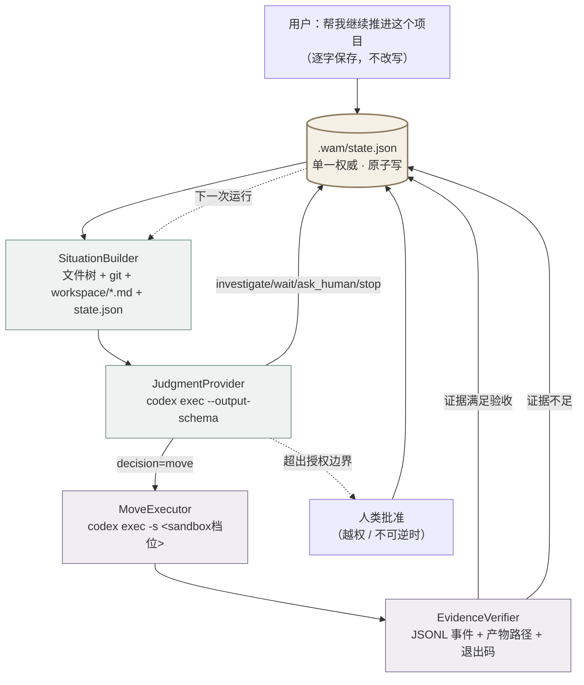
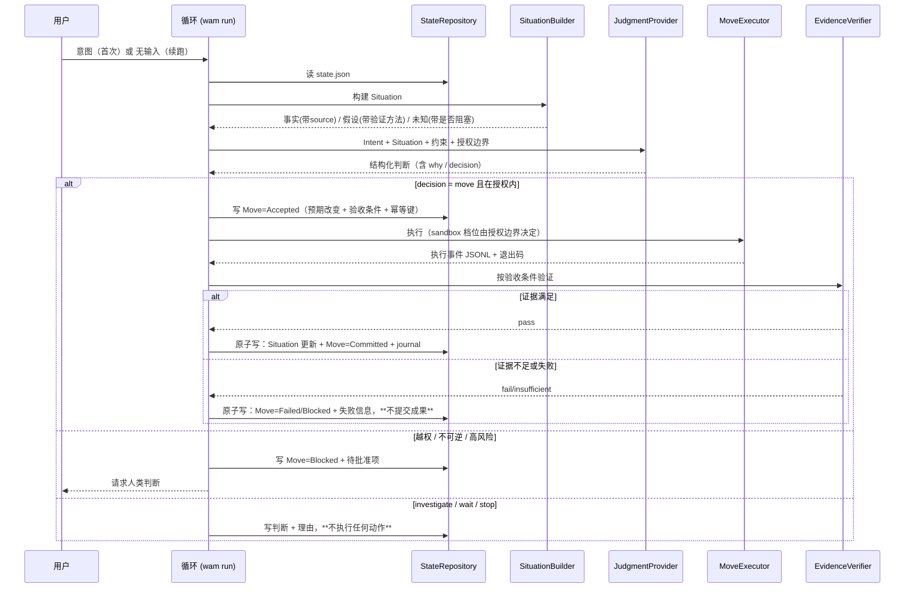
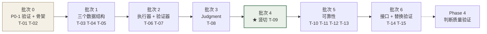

# Development Plan — MVP 开发计划（工程版）

> 版本：2026-10-09 v3 · 状态：**Current Design Baseline**（计划已定，**§13 开工批次待作者审阅**，未执行）
> v3 变更：新增 §13 开工批次计划（可直接交给开发 Agent 执行）与 §14 待裁决清单。
> 本文档是**工程做法的权威**（时间安排以 `docs/development/roadmap.md` 为准）。v1（2026-10-09 上午）的高层阶段划分已并入本文档 §9。
> 依赖：`docs/vision.md`（概念）· `docs/architecture.md`（架构）· `docs/specifications/state-and-evidence.md`（状态与 Move 语义）
> 决策状态：`docs/decisions/register.md` · 验收场景：`docs/specifications/acceptance.md`
> **2026-11-10 结构说明**：§5–§7（接口集 / `state.json` 结构 / Move 生命周期）已原文移至 [`docs/specifications/execution-contract.md`](../specifications/execution-contract.md)，**节号保留**；本文只承载工程做法与环境基线。

---

## 0. 中心问题与本计划的取舍立场

> **当 WAM 没有自己的渴望，而用户的目标又不一定能被量化时，WAM 如何根据用户意图和真实处境形成好判断，并把判断转化为可验证、可持续的建设？**

本计划承认：**复杂情境下的智慧判断、开放式目标理解、反事实推演、长期自我修正，现在都做不好。**

策略因此是三条：

1. **不假装。** 不把 LLM Prompt 包装成 Wisdom Engine，不把评分器包装成 Judgment，不把任务队列包装成项目推进。
2. **先造一个真能跑的最小闭环。** 一个有限、明确、可检查的判断过程，能不能真正驱动项目持续推进——这是要验证的，不是要证明的。
3. **为未来留接口，但只留有替换理由的接口。** 不为"以后可能需要"增加抽象层。

**一句话目标**：先做一个能判断、行动、验证、更新、恢复的微型 WAM，再逐步增强它的判断能力。

---

## 1. Phase 0：工程基线（本次已完成核查）

**目标**：确定实现选择，不写产品代码。

### 1.1 已验证的环境事实

| 项 | 结论 | 验证方式 |
|---|---|---|
| Python | **3.13.12 可用**，stdlib 完整（json / subprocess / hashlib / uuid / datetime / pathlib / unittest / tomllib 全部存在） | 实际 import 探测，17/17 通过 |
| Node | 22.22.2 可用 | `node -v` |
| **codex-cli** | **0.138.0 已安装**。`codex exec` 支持 `--output-schema <FILE>`（schema 约束的结构化输出）、`--json`（JSONL 事件流）、`-s read-only\|workspace-write\|danger-full-access`（sandbox 档位）、`exec resume --last`（续接） | `codex --help` / `codex exec --help` |
| DeepSeek Harness | npm 上有 `@deepseek-ai/dsh@0.2.0-rc.2`，registry 可达；本机 `node_modules` **未安装**，本轮未验证可运行 | `npm view` / 目录检查 |
| LLM 端点 | 环境里的 `OPENAI_BASE_URL`（new.sharedchat.cc）**实测 403**，`/models` 与 `/chat/completions` 均被网关拒绝 | 实际发请求，403 / "该接口未接入公益站独立网关" |
| 仓库代码 | **零实现代码**（29 个 tracked 文件，全 md/html/css/yml） | `git ls-files` |

### 1.2 因此做出的三个实现选择

| 选择 | 结论 | 依据 | 替代方案与为何不选 |
|---|---|---|---|
| **语言** | **Python 3.13，零第三方依赖** | stdlib 已覆盖全部所需能力（原子写入用 `os.replace` + `tempfile`，哈希用 `hashlib`，测试用 `unittest`）。安装零风险 | DSH 是 TypeScript，但 DSH 本机未验证可运行；为一个未验证的运行时押上整个 MVP 不划算。**这不改变 DSH 作为未来执行器的可能性**（§4 的 MoveExecutor 接口就是为此留的） |
| **执行器 / Judgment 提供者** | **codex-cli 作为第一个实现** | 它同时解决了三件事：①`--output-schema` 给出 schema 约束的判断输出；②`-s read-only/workspace-write` 天然就是**授权边界的执行点**；③`--json` 给出可检查的执行事件 | 直连 LLM API 不可行（端点 403）。DSH preset 是备选，等它可运行后再接 |
| **持久化** | **单个 `state.json`，原子写入** | 「更新不自相矛盾」要求单文件单次写；多文件 Markdown 更新无法保证原子性，会重演 WAM 自己要解决的 state desync | `workspace/*.md` 直接作为机器权威（见 §1.3 的冲突处理） |

### 1.3 一个必须记录的设计冲突

`docs/foundation.md`（M0 宪法）规定：**所有协作状态放在 `workspace/` 的四个 Markdown 文件里，人和 AI 都直接读写。**

而本计划的 MVP 选择 `state.json` 作为机器权威。两者冲突，处理方式：

- **`state.json` 是循环的权威状态**（单一文件、原子写、机器可读）。
- **`workspace/*.md` 降级为「证据来源」**：Situation 构建时把它们读进来（它们是人手写的真实观察），但循环不回写它们。
- **两者不冲突的原因是 MVP 不在 WAM 仓库自身上跑**（§3.2）。若要在 WAM 仓库上 dogfood，会立刻出现"人改 md / 机器改 json"的双权威问题——这已记为 Open Question **OQ-18**，不掩盖。

**这是对 M0 的一处偏离，不是对 M0 的推翻。** M0 的四文件仍然是人类协作的约定界面。

### 1.4 Phase 0 遗留（必须在 Phase 1 开工前解决）

| # | 事项 | 阻塞什么 | 最小验证 |
|---|---|---|---|
| P0-1 | **codex 认证状态未验证**（本轮沙箱禁止访问 `~/.codex`） | Phase 1 全部（Judgment 与执行都靠它） | 在项目终端跑一次 `codex exec --ephemeral -s read-only "reply ok"`，看是否返回 |
| P0-2 | `state.json` 的 schema 版本化策略 | 长期可维护 | Phase 1 定 `version: 1`，写迁移函数骨架即可，不需要真的迁移 |

---

## 2. 能力分类：A 必须做 / B 最小版本留接口 / C 推迟

### 2.1 A 类：现在必须实现（构成微型闭环）

| # | 能力 | 具体形态 | 为什么现在能做 |
|---|---|---|---|
| A1 | 接收并保存用户意图 | 原话逐字保存 + 目标/约束/授权边界结构化 | 纯数据 |
| A2 | 检查工作区 | 文件树 + `git status` + 读 `workspace/*.md` + 读 `state.json` | 纯读取 |
| A3 | 建立最小 Situation | 事实（**必须带 source**）/ 假设（**必须带验证方法**）/ 未知（**必须带是否阻塞**） | 纯数据结构 |
| A4 | 形成有理由的下一步判断 | 单次 codex 调用 + JSON Schema 约束 + 降级路径 | codex `--output-schema` 已验证存在 |
| A5 | 产生一个 Move | 四要素齐备（意图/前提/预期改变/验收条件） | 纯数据结构 |
| A6 | 执行受限动作 | `codex exec -s <sandbox档位>`，档位由授权边界决定 | codex sandbox 已验证存在 |
| A7 | 取得可检查证据 | 执行事件 JSONL + 产物路径存在性 + 退出码 | 纯读取 |
| A8 | 依据证据更新状态 | 单文件原子写；**证据不足则不写** | `os.replace` |
| A9 | 中断后恢复 | 启动时读 `state.json` + 恢复 Active Move + 幂等键检查 | 纯读取 |
| A10 | 证据不足/越界时暂停 | 三条降级路径：解析失败→`Blocked`；证据不足→不提交；越权→`Blocked` 并要求人类批准 | 纯逻辑 |

**A 类的边界**：这 10 项不是 10 个模块。Phase 1 会把它们实现为**一条竖切**，Phase 3 才从中抽出接口。

### 2.2 B 类：只做最小版本，预留替换接口

| 能力 | 未来接入点 | MVP 最小实现 | 替换理由 |
|---|---|---|---|
| 更强的 Situation 构建与上下文压缩 | `SituationBuilder` | 文件树 + git + 现有 md；**不压缩、不摘要** | 文档已长到需要压缩，但压缩有无正确性保证未知（`docs/specifications/state-and-evidence.md` §7、`research/briefs/02`）。**先测量长度，再决定是否压缩** |
| 更复杂的 Judgment | `JudgmentProvider` | 单次调用 + schema | 这是最该被替换的一块（§5） |
| 多候选方案比较 / 反事实推演 | `JudgmentProvider` 的实现内 | **不实现**。输出结构里预留 `alternatives_considered` 字段但允许为空 | 结构上有位置，就不会在加能力时改动循环 |
| 更完整的未知发现与研究策略 | `SituationBuilder` + `JudgmentProvider` | 只登记未知，不主动生成研究任务 | 无监督的 unknown-unknown 检测是未解问题（`research/briefs/03`）。WAM 的贡献是显式登记 + 人在回路 |
| 更可靠的长期记忆组织 / 项目关系模型 | `StateRepository` | 单文件扁平结构 | Project Graph 明确推迟（`docs/architecture.md` §8.2） |
| 多 Agent 协调 | `MoveExecutor` | 单执行器 | P7：Move 边界未稳定前不谈并行 |
| 可插拔模型 / 执行器 / 验证器 / 存储后端 | 全部 6 个接口 | 单实现（codex / 内建验证器 / JSON 文件） | 每个接口都有具体的替换理由（§5），不是为了"可扩展" |
| 更复杂的风险评估与人工介入 | `MoveExecutor` 的 sandbox 档位 + `state.json` 的 `authorization` | 三档 sandbox + 三类需批准动作 | 企业级权限系统推迟，但**边界必须现在就有** |

### 2.3 C 类：明确推迟

| 推迟项 | 推迟原因 | 未来接入位置 | 触发开发的证据 |
|---|---|---|---|
| 完整多 Agent 系统 | Move 边界未稳定；并行规则会反向约束边界设计（P7） | `MoveExecutor` 多实现 | 单执行器成为明确瓶颈（连续 N 次 Move 因执行器能力不足失败） |
| 复杂自主规划与调度系统 | "规划"不等于"判断"。当前需要的是判断被验证，不是规划器 | `JudgmentProvider` 内 | Judgment 质量达标但成为吞吐瓶颈 |
| 完整 Wisdom Engine | **现在做就是假装。** 六个启发式维度是观察视角，不是模块清单 | `JudgmentProvider` | 见 §8 Phase 4 |
| 通用反事实世界模拟 | 成本极高，且当前无任何证据表明它会改变 Move 质量 | `JudgmentProvider` | Phase 4 失败分析显示"缺少对替代路径的评估"是主要失败原因 |
| 高度复杂的动态项目图 | 依赖结构 ≠ 重要性；在判断质量未验证前建图，正是 P2 要防的事 | `StateRepository` | 扁平结构真实暴露检索痛点 |
| 插件市场 / 分布式运行时 | 无需求证据 | 不预设 | 出现第二个真实使用方 |
| 复杂可视化界面 | Dashboard 已有计划（`docs/development/dashboard-plan.md`），P1 优先级在 MVP 之后 | `docs/development/dashboard-plan.md` P1–P4 | MVP 闭环跑通 |
| 通用化抽象 | 1% 原则 | — | **默认永远不实现**，除非某个具体失败案例指向它 |
| 向量检索作主状态存储 | 检索失效风险；已在反借鉴清单 | 不作为主存储 | — |

---

## 3. 微型闭环与验收场景

### 3.1 数据流（实际 MVP）



**实线 = Phase 1 就要真实跑通的。** 唯一允许的"未来扩展点"是 `JudgmentProvider` 内部——Phase 1 它是一次调用，Phase 4 后它可能变成候选比较，而**循环其余部分不改**。

### 3.2 MVP 核心验收对象

**场景**：一个专用的小型真实项目（`experiments/mvp-loop/` 下的 fixture 项目：已有部分代码、一份实验记录、一个已知但未修的问题）。用户第一次输入：

> 帮我继续推进这个项目。

**不**在 WAM 仓库自身上跑（原因见 §1.3 的双权威冲突）。

**一次闭环的最小数据流**：

```
User Intent → Inspect Workspace → Current Situation → Judgment
   → One Active Move → Execution → Evidence → State Update → Resume
```

### 3.3 闭环通过判据（硬性）

| # | 判据 | 怎么算 |
|---|---|---|
| 1 | **产生至少一次可验证的真实变化** | 有文件/测试/提交的实际改变，且能被独立检查。**只生成计划、只写 JSON、只声称完成 = 不通过** |
| 2 | 第 9 步不是重复旧任务 | 第二次运行的 Judgment 理由与第一次不同，且引用了新证据 |
| 3 | 全程无伪造成功 | 每次 `Committed` 都能追到一份通过验收的证据 |
| 4 | 中断后可恢复 | 进程 kill 后重启，能恢复 Active Move 并识别是否执行到一半 |

---

## 4. 核心架构与数据流

### 4.1 一次循环的真实执行顺序



### 4.2 失败与状态不一致的防护

| 风险 | 防护 |
|---|---|
| 状态写到一半 | 单文件 + `tempfile` + `os.replace`（同文件系统内原子） |
| 执行成功但证据不足 | `Verifying` 是独立状态，**`Executing` 永远不能直接跳到 `Committed`** |
| 验证器自身抛错 | 捕获 → 记为 `insufficient` → **不提交**（默认保守） |
| 判断输出无法解析 | JSON Schema 校验失败 → `Blocked` + 记录原始输出 → 请求人类。**不猜、不重试超过 1 次** |
| 执行器超时 | 同上，`Blocked`，记录已产生的部分证据 |

---

> **§5–§7 已移至** [`docs/specifications/execution-contract.md`](../specifications/execution-contract.md)：接口集、`state.json` 结构与 Move 生命周期。**原文与节号未改**，此处保留节号空档。

---

## 8. 工程任务列表

> 顺序原则：**尽早验证微型闭环**，不按理想架构自底向上先建所有模块。T-04 之前不写任何抽象层。

| ID | 任务 | 依赖 | 交付物 | 验收条件 |
|---|---|---|---|---|
| **T-01** | 工程骨架 | — | `.wam/state.json` schema v1 + `NoState`/`CorruptState` 错误路径 + `unittest` 骨架 | `state.json` 原子写：写入中断后旧文件仍完整可读；损坏文件不被覆盖 |
| **T-02** | `StateRepository`（I6） | T-01 | `load` / `save` / `init` | 写 100 次无损坏；`save` 后立即 `load` 内容一致 |
| **T-03** | `SituationBuilder`（I2） | T-02 | 文件树 + `git status --porcelain` + 可选读 `workspace/*.md` | 三类记录（facts/assumptions/unknowns）都能产生；**无 `source` 的 fact 被拒绝** |
| **T-04** | Intent 解析 + 授权边界 | T-02 | `origin` 字段、三档 sandbox 推导、黑名单 | `origin=inferred` 的目标在输出中可区分；`deny` 命中时 sandbox 档位强制降级为 `read-only` |
| **T-05** | Move 数据结构 + 四要素校验 | T-04 | `Move` 构造 + 校验 | 缺任一要素 → 停在 `Proposed`；`acceptance` 为空 → 拒绝 |
| **T-06** | `MoveExecutor`（I4）+ codex 接入 | T-05, **P0-1** | `codex exec` 子进程封装，JSONL 事件收集 | 能在 fixture 项目跑一次真实执行；非零退出码作为 `ok=false` 返回而非异常 |
| **T-07** | `EvidenceVerifier`（I5） | T-05 | 三类 criterion：`command_exit` / `file_exists` / `output_contains` | 每类各一个测试；验证器自身抛错 → `insufficient` |
| **T-08** | `JudgmentProvider`（I3）+ JSON Schema | T-04, T-05 | schema 文件 + `codex exec --output-schema` 接入 | 合法输入 → 通过 schema；非法输入 → `JudgmentUnavailable` → `Blocked`，**不重试超过 1 次** |
| **T-09** | **竖切串起来（第一次端到端）** | T-06, T-07, T-08 | `wam run` 单次循环 | **§3.3 的 4 条判据全部满足**。这是第一个里程碑 |
| **T-10** | 幂等与中断恢复 | T-09 | `idempotency_key` + 恢复逻辑 + 进程 kill 测试 | `reversible: false` 的 Move 中断后**不自动重试**，转 `needs_human` |
| **T-11** | 三条降级路径 | T-09 | 解析失败 / 证据不足 / 越权 | 每条都能实际触发，且都不产生虚假 `Committed` |
| **T-12** | 失败信息回写 Situation | T-09, T-10 | 失败 → 新 fact + `refuted` 假设 | 同一失败连续发生 3 次时，第 2 次起 Judgment 的 `why` 必须引用失败信息（**否则判定无效**） |
| **T-13** | 自动化测试套件 | T-09–T-12 | 覆盖 §9.1 全部用例 | `python -m unittest` 全绿；每个用例有独立 fixture |
| **T-14** | **抽出 6 个接口** | T-13 | 接口定义（此时才有真正的实现可抽） | 循环行为在抽取前后**逐字节相同的 `journal/` 序列** |
| **T-15** | 接口替换验证 | T-14 | 至少 1 个接口用**假实现**替换验证边界真实存在 | 换掉 `JudgmentProvider` 为"永远返回 ask_human"后，循环仍能正确走到 `Blocked` 并写入 |

> **T-14 在 T-09 之后**：在竖切跑通之前抽接口，等于按想象抽抽象。**先有真实实现，才知道边界在哪。**

---

## 9. 阶段门与测试

### 9.1 验收用例

| # | 用例 | 类型 | 怎么测 | 对应 |
|---|---|---|---|---|
| A1 | **正常闭环** | 集成 | fixture 项目跑一次，检查产物实际改变 + `Committed` 有证据引用 | §3.3 |
| A2 | **已有项目** | 集成 | fixture 预置代码与实验记录；断言 Situation 包含它们，且**未重复初始化** | T2（`docs/specifications/acceptance.md`） |
| A3 | **执行失败** | 单元 | 假执行器返回非零；断言**无 `Committed`**、状态写的是失败信息 | T-06 |
| A4 | **证据不足** | 集成 | 假执行器返回成功但产物不存在；断言 `Verifying` → `Failed`/insufficient，**不提交** | T-07, T-11 |
| A5 | **中断恢复** | 集成 | 在 `Executing` 中 kill 进程；重启后断言恢复 Active Move 并按幂等规则决策 | T-10 |
| A6 | **重复执行** | 集成 | 同 A5，但 Move 为 `reversible: false`；断言**不自动重试** | T-10 |
| A7 | **判断失败** | 单元 | 假 Judgment 返回非法 JSON；断言 → `Blocked` + 原始输出留证 + 请求人类 | T-08 |
| A8 | **授权边界** | 集成 | Move 含 `force_push`；断言 sandbox 降级 + `require_approval_for` 命中 → `Blocked` | T-04 |
| A9 | **无可靠下一步** | 集成 | Situation 全是 `blocking: true` 的未知；断言 Judgment 可选 `wait`/`ask_human` 且**不执行任何动作** | T-08 |
| A10 | **无数值目标** | 人工 | 开源/社科类 fixture，无任何数字指标；断言 Move 的 `why` 引用 Intent 与事实，**而非分数** | T-09 |
| A11 | **状态损坏** | 单元 | 写入非法 JSON；断言 `CorruptState` 且**文件未被覆盖** | T-01 |
| A12 | **假设不自动升级** | 单元 | 时间推进 + 无新证据；断言 `assumptions[].status` 仍为 `unverified` | T-03 |

**A1–A9 可自动化。A10 必须人工判断**——判断质量无法用断言表达，这是 `docs/specifications/acceptance.md` §5 的立场。

### 9.2 阶段门

| Phase | 目标 | 完成条件 | 验证方式 | 未通过时怎么办 |
|---|---|---|---|---|
| **0** 工程基线 | 确定实现选择 | §1.1 全部核查完成 + 三个选择有依据 + P0-1/P0-2 有结论 | 本文档即证据 | 修文档，不进 Phase 1 |
| **1** 最小闭环 | T-01→T-09 | §3.3 的 4 条判据全部满足 | A1, A2, A11 集成测试 + **人工实际跑一次 fixture** | **修复**。若 T-08 的 Judgment 反复不可靠 → **缩小范围**到"人工指定 Move"的半自动模式，先把闭环其余部分跑通 |
| **2** 可靠性 | T-10→T-13 | 关键失败路径全部有自动化测试 | A3–A9, A12 | **修复**。若幂等规则无法可靠实现 → **停止 Phase 3**，先解决（不可靠的幂等比没有幂等更危险） |
| **3** 固定接口 | T-14→T-15 | 6 个接口定义 + 至少 1 个被假实现替换验证 | 抽取前后 `journal/` 序列逐字节相同 | **缩小范围**：只保留真正被验证过的接口，其余降为普通函数 |
| **4** 验证判断质量 | 用真实案例检验 Judgment | 至少 2 个案例（含 1 个无数值指标）跑出完整闭环 + 失败分析 | 人工评审 + `docs/specifications/acceptance.md` 场景验收 | **失败就是收获**：失败模式写进 `docs/decisions/register.md`，判断机制按证据修订。**不为了通过而调 prompt 直到看起来好** |

**阶段门不是流程。每一条都必须能回答"未通过怎么办"——如果答案是"继续做别的"，那这条门就没设计好。**

### 9.3 明确不做的事（防止 Phase 扩张）

Phase 1–2 **不做**：任何 Dashboard 代码、任何 `directions/` 切片、任何 Sponge 侧集成、任何真实场景（Kaggle/论文复现）跑批、任何模型对比。

**理由**：Phase 1–2 的唯一目标是"微型闭环可靠"。并行做别的会重演 2026-08-15 诊断出的失败模式。

---

## 10. 风险与未决问题

### 10.1 现在做不好的能力（诚实清单）

| 能力 | 现在做不到 | 计划里的位置 |
|---|---|---|
| 复杂情境下的智慧判断 | 只能做"受限的、基于当前信息的下一步判断" | I3 的 MVP 实现 |
| 开放式目标理解（模糊意图） | Intent 需要用户提供，`origin=inferred` 的目标不可信 | A1 / I1 |
| 反事实推演 | 不做。`alternatives_considered` 字段留位，允许为空 | I3 |
| 长期深层自我修正 | 无。没有判断命中率统计 | Phase 4 之后 |
| 自动发现 unknown-unknown | **原理上未解**（`research/briefs/03`）。WAM 的贡献是显式登记 + 人在回路，不是自动检测 | I2 |
| 上下文压缩下的判断可靠性 | 不压缩。先测量长度，超限再说 | I2 |
| Human Absent 自主运行 | **不具备**。授权边界表达虽已定义，但无人监督下的越权检测未实现 | C-10 要求的路径见 `docs/architecture.md` §10.2 |

### 10.2 设计风险

| 风险 | 早期信号 | 缓解 |
|---|---|---|
| **Phase 1 又变成写文档** | T-09 的日期推后 | §9.3 已限制并行工作；T-09 是唯一里程碑 |
| **接口抽早了** | T-14 之前出现 `Provider`/`Factory` 类 | T-14 明确依赖 T-13 |
| **Judgment 是"看起来像判断的套话"** | T-08 的输出读起来像模板 | Phase 4 专门检验；`why` 必须引用具体 fact id（可自动检查） |
| **JSON schema 太严导致频繁降级** | `JudgmentUnavailable` 频发 | schema 允许 `alternatives_considered` 等可空字段；频发则放宽而非放弃 |
| **codex 认证在别的机器上不可用** | P0-1 通过但换环境失败 | I3/I4 是接口，换实现即可 |
| **Mini-project 太简单导致虚假信心** | Phase 4 一次通过 | Phase 4 必须含无数值指标案例 |
| **`state.json` 体积膨胀** | `state.json` > 200KB | 不自动压缩（`docs/specifications/state-and-evidence.md` §7）；先测量 |

### 10.3 决定何时进入下一阶段的依据

**只依据可观察证据，不依据完成度百分比。**

| 进入 | 依据 |
|---|---|
| Phase 1 → 2 | §3.3 的 4 条判据在 fixture 上**实际满足过一次** |
| Phase 2 → 3 | A3–A9、A12 全部自动化通过，且 A6（不可逆 Move 的重复执行）**在真实 kill 场景下**验证过 |
| Phase 3 → 4 | 换掉任一接口后循环仍正确 |
| Phase 4 完成 | 至少 2 个案例有完整记录——**包括失败的**。全是成功记录说明案例太简单 |

---

## 11. 开发启动结论

### 11.1 现在可以直接开始

| 工作 | 为什么可以 |
|---|---|
| T-01, T-02（骨架 + StateRepository） | 纯 Python stdlib，无外部依赖，无阻塞 |
| T-03, T-04, T-05（Situation / Intent / Move 数据结构） | 同上 |
| T-13 的测试骨架 | 同上 |

**这些加起来是可靠的**：不依赖 codex、不依赖 LLM、不依赖网络。

### 11.2 已有依据的技术选择

| 选择 | 依据强度 |
|---|---|
| Python 3.13 + 零依赖 | **强**（stdlib 已实测完整） |
| codex-cli 作第一执行器/Judgment | **强**（版本与全部所需 flag 已实测） |
| 单文件 JSON 原子写 | **强**（直接服务于"更新不自相矛盾"） |
| 三档 sandbox 作授权边界 | **中**（codex 提供档位，但"档位推导规则"是我方的设计，未验证） |
| MVP 不在 WAM 仓库 dogfood | **强**（双权威冲突是确定的，OQ-18） |

### 11.3 必须先确定的接口

**只有三个必须在写代码前定下来**（其余可在 T-14 抽）：

| 接口 | 必须先定的原因 |
|---|---|
| **I2 SituationBuilder** 的输出结构 | `state.json` 的 `situation` 三类字段是循环的输入。**改它等于改整个循环** |
| **I3 JudgmentProvider** 的输出 schema | 同上，且 schema 决定了"判断是否可解析"。**这是最可能需要反复改的一处** |
| **I5 EvidenceVerifier** 的 criterion 种类 | 决定验收条件怎么写。criterion 种类太少会逼用户写假验收 |

**I4 的 sandbox 档位推导规则**必须先有**可用版本**（可以粗糙），但不要求最终形态。

### 11.4 可以留到闭环跑通之后

一切。**包括**：接口的最终形态、更多 criterion 类型、并行执行、多执行器、更强的 Situation、状态压缩、真实的 Dashboard、真实场景跑批。

**唯一不能留的是 Intent 与授权的表达**——它们是判断的锚点，晚定等于整个循环要重写。

### 11.5 是否存在真正阻碍 MVP 的问题

**没有。** 可以开工。

但有**三个必须在 Phase 1 期间解决、不阻塞开工**的项：

| # | 项 | 处理 |
|---|---|---|
| 1 | codex 认证状态未验证 | T-06 之前跑一次 `codex exec --ephemeral -s read-only`。**不通则 I3/I4 换实现**（接口已留好），不影响 T-01–T-05 |
| 2 | 沙箱档位推导规则未验证 | Phase 1 用最保守版本（默认 `read-only`，需批准才升级），Phase 2 再放宽 |
| 3 | Judgment 的 schema 可能需要反复调 | 预留预算。**如果调 3 次仍不稳定，说明 I3 的边界定错了**——此时回到设计，不要继续调 prompt |

**有一件事会阻碍后续，但不阻碍 MVP**：`docs/decisions/register.md` OQ-09（WAM 与 Sponge 的关系）未裁决。若结论是"基于 Sponge"，I2 的实现位置可能变（Statuz 作为信息源）。**但 MVP 不依赖它**——这是刻意的：让 MVP 不被任何未裁决的架构争议阻塞。

---

## 12. 开工批次计划（待作者审阅）

> **2026-10-28 注**：本节的 7 个批次已被 [`docs/development/roadmap.md`](roadmap.md) **时间化**为 W0–W9（批次内容不变，加上了日期、每周 E1 退出条件与固定砍单顺序）。**执行时以 `docs/development/roadmap.md` 为准**；本节保留为历史记录与被取代的原始表述。另：§1.2 的 codex 执行器选择已被环境证伪（`docs/decisions/register.md` B-15 / X-10），代码级内容（§5 接口、§6 schema、§7 生命周期、§8 任务）不受影响。

> 本节把 §8 的任务列表排成**可交付的批次**。每个批次有明确的产物、验证方式和退出条件。
>
> **本文档只到"计划"为止。批次 0 的代码尚未开始编写**——见 §14 待裁决清单，其中两项未裁决前不建议动 T-08。

### 12.1 批次总览



**批次 4 是唯一的里程碑。** 在它之前的所有批次都只是"零件"，只有它能把零件变成闭环。

### 12.2 批次 0：验证与骨架

| 项 | 内容 |
|---|---|
| **任务** | P0-1（验证 codex 认证）· T-01（工程骨架 + schema v1）· T-02（StateRepository） |
| **产物** | `src/wam/` 包骨架 · `.wam/state.json` schema v1 · `I6StateRepository` 的 `load`/`save`/`init` · `NoState`/`CorruptState` 错误路径 |
| **验证方式** | `python -m unittest tests.test_state`：① 连续写 100 次无损坏 ② 写入中断后旧文件仍完整可读 ③ 损坏 JSON 不被覆盖 ④ `save` 后立即 `load` 内容一致 |
| **退出条件** | 上述 4 条全绿 **且** P0-1 有明确结论（可用 / 不可用） |
| **不在本批次** | 任何 Situation、Judgment、执行逻辑 |
| **风险** | 无。这是纯本地、无外部依赖的工作 |

### 12.3 批次 1：三个数据结构

| 项 | 内容 |
|---|---|
| **任务** | T-03 SituationBuilder · T-04 Intent 解析 + 授权边界 · T-05 Move 结构 + 四要素校验 |
| **产物** | `I1IntentProvider` · `I2SituationBuilder` · `Move` 结构与校验 · sandbox 档位推导（保守版）· 路径黑名单 |
| **验证方式** | `python -m unittest`：① 三类 Situation 记录都能产生 ② **无 `source` 的 fact 被拒绝入库** ③ `origin=inferred` 的目标在输出中可区分 ④ `deny` 命中时档位强制降为 `read-only` ⑤ 缺 Move 四要素任一项 → 停在 `Proposed` ⑥ `acceptance` 为空 → 拒绝 |
| **退出条件** | 上述 6 条全绿 |
| **不在本批次** | 调用 codex、任何 LLM |
| **风险** | 字段设计若在 T-09 后发现不足，需回到本批次改。**这是设计上接受的代价**（先有真实实现，才知道字段对不对） |

### 12.4 批次 2：执行器与验证器

| 项 | 内容 |
|---|---|
| **任务** | T-06 MoveExecutor + codex 接入 · T-07 EvidenceVerifier |
| **产物** | `codex exec` 子进程封装 + JSONL 事件收集 · 三类 criterion：`command_exit` / `file_exists` / `output_contains` |
| **验证方式** | ① 在 fixture 跑一次真实执行 ② 非零退出码作为 `ok=false` **返回而非抛异常** ③ 每类 criterion 各一个测试 ④ **验证器自身抛错 → `insufficient`（不提交）** |
| **退出条件** | 上述 4 条全绿 |
| **不在本批次** | Judgment。执行器接受"人工指定一个 Move"来测试 |
| **风险** | codex 认证若不可用 → I4 换实现（人工执行 + 手工填证据）。**接口不变，循环不变** |

### 12.5 批次 3：Judgment

| 项 | 内容 |
|---|---|
| **任务** | T-08 JudgmentProvider + JSON Schema |
| **产物** | `judgment.schema.json` · `codex exec --output-schema` 接入 · 降级路径 |
| **验证方式** | ① 合法输入通过 schema ② 非法输入 → `JudgmentUnavailable` → `Blocked` ③ **不重试超过 1 次** ④ 原始输出留证 |
| **退出条件** | 上述 4 条全绿 **且** schema 已被连续 3 次不同输入验证稳定（对应 OQ-21） |
| **不在本批次** | 多候选、反事实、评分 |
| **风险** | **本批次最可能需要反复**。若调 3 次仍不稳 → **停止，回设计**（OQ-21），不要继续调 prompt |

### 12.6 批次 4：竖切（★ 唯一里程碑）

| 项 | 内容 |
|---|---|
| **任务** | T-09 |
| **产物** | `wam run` 单次循环：意图 → Situation → Judgment → Move → 执行 → 证据 → 状态更新 |
| **验证方式** | §3.3 的 4 条判据 + A1（正常闭环）· A2（已有项目）· A11（状态损坏）· **人工实际在 fixture 项目跑一次并肉眼确认产物真的变了** |
| **退出条件** | 4 条判据全满足。**其中判据 1（至少一次可验证的真实变化）是硬性的**——只生成计划、只写 JSON、只声称完成 = 不通过 |
| **不在本批次** | 中断恢复、幂等、失败回写（这些是批次 5） |
| **风险** | **Phase 1 又变成写文档**——头号风险。结构性缓解：本批次前三个批次都已产出可运行代码，若此刻还在写文档，说明 T-09 的定义本身有问题，需重新审视 |

### 12.7 批次 5：可靠性

| 项 | 内容 |
|---|---|
| **任务** | T-10 幂等与中断恢复 · T-11 三条降级路径 · T-12 失败信息回写 Situation · T-13 自动化测试套件 |
| **产物** | `idempotency_key` 机制 + 恢复逻辑 · 三条降级路径实现 · 失败 → 新 fact + `refuted` 假设 · 覆盖 §9.1 全部用例的测试 |
| **验证方式** | A3–A9 + A12。**其中 A6（不可逆 Move 的重复执行）必须在真实 kill 场景下验证，不能只靠 mock** |
| **退出条件** | A3–A9、A12 全部自动化通过，且 A6 在真实 kill 场景验证过 |
| **不在本批次** | 接口抽取 |
| **风险** | 幂等规则若无法可靠实现 → **停止批次 6**。不可靠的幂等比没有幂等更危险 |

### 12.8 批次 6：接口与替换验证

| 项 | 内容 |
|---|---|
| **任务** | T-14 抽出 6 个接口 · T-15 假实现替换验证 |
| **产物** | 6 个接口定义 · 至少 1 个接口的假实现 |
| **验证方式** | ① 抽取前后 `journal/` 序列**逐字节相同** ② 换掉 `JudgmentProvider` 为"永远返回 `ask_human`"后，循环仍能正确走到 `Blocked` 并写入 |
| **退出条件** | 上述 2 条 |
| **不在本批次** | 第二套生产实现。**假实现足够**——目的是证明边界真实存在，不是证明架构可扩展 |
| **风险** | 若某个接口无法被替换验证 → 它不是一个真边界，**降为普通函数** |

### 12.9 批次与验收用例的对应

| 批次 | 覆盖的验收用例 |
|---|---|
| 批次 0 | A11 |
| 批次 1 | A8, A12（结构层面） |
| 批次 2 | A3, A4 |
| 批次 3 | A7, A9 |
| **批次 4** | **A1, A2, A10** |
| 批次 5 | A5, A6, A8, A9（行为层面） |
| 批次 6 | 全部的边界稳定性 |

---

## 13. 待裁决清单（作者审阅）

### 13.1 必须先裁决，否则某一批次无法开始

| # | 事项 | 我的建议 | 不裁决的后果 |
|---|---|---|---|
| **1** | **P0-1：codex 是否已在本机登录？** 请在项目终端跑 `codex exec --ephemeral -s read-only "reply ok"` | — | 批次 2 无法开始。这是唯一的硬阻塞 |
| **2** | **`.wam/state.json` 的 `intent` / `authorization` 结构**（`docs/development/mvp-plan.md` §6.2 的草案） | 采纳草案。它是 `origin=inferred` 与授权边界推导的落点 | 批次 1 的 T-04 无法定稿 |
| **3** | **acceptance criterion 的三类是否够用**（`command_exit` / `file_exists` / `output_contains`） | 够用。不足时再加——**criterion 太少会逼人写假验收，太多会让验收变成形式** | 批次 1 的 T-05 校验规则无法定稿 |

### 13.2 不阻塞开工，但建议裁决

| # | 事项 | 我的建议 |
|---|---|---|
| 4 | **OQ-18：MVP 是否接受不在 WAM 仓库 dogfood**（B-13） | 接受。等有了单一写入点的方案再谈 WAM 跑自己 |
| 5 | **OQ-09：WAM 与 Sponge 的关系** | **不阻塞 MVP**，但若结论是"基于 Sponge"，批次 1 的 T-03 实现位置可能变（Statuz 作为信息源） |
| 6 | **OQ-06b 已关闭**（Python） | 已定，无需裁决 |
| 7 | **批次顺序是否认可**（先 T-01–T-05 可立即开工，T-14 最后抽接口） | 认可。**提前抽接口是这份计划最容易违反的一条** |

### 13.3 需要你在 Phase 4 之前回答的

| # | 问题 | 为什么必须由你回答 |
|---|---|---|
| 8 | 场景 C（开源建设）的验收对象是什么？无单一指标，"做完了"需要外部判定 | 只有项目作者能定义"这个项目值得做" |
| 9 | Phase 4 用哪两个案例？ | 选案例等于选 WAM 要证明自己能处理什么 |

---

## 14. 这份计划的自我评估

**它最强的地方**：

- 三个技术选择都有实测依据，包括两个**探测失败**（LLM 端点 403、codex 认证未验证）。没有一句"应该可以"。
- 6 个接口每个都有具体替换理由，且列出了**刻意不设的 5 个**。
- 每个阶段门都写了"未通过怎么办"，包括"失败就是收获"和"停止，不要继续"。
- Task 顺序刻意让接口抽取最后发生。

**它最弱的地方（必须说）**：

| 弱点 | 说明 |
|---|---|
| **所有数据字段都是设计出来的，没跑过一次** | `state.json` 的 schema、Move 的四要素字段，都可能在批次 4 才发现不够用。这是本计划最大的不确定性，**不是靠更多设计能消除的，只能靠跑** |
| **Judgment 质量完全未测** | 批次 3 只保证"输出可解析"，不保证"判断是对的"。唯一的检验在 Phase 4，**而 Phase 4 在很后面**。若 Judgment 的 `why` 全是套话，会浪费一个 Phase 才被发现 |
| **A10（无数值目标）无法自动化** | 设计原则 C-05 说不制造伪指标，但这条恰好是最难测的一条 |
| **本文档已 723 行** | 违反 1% 原则的自嘲风险。**但压缩它的代价是让开发 Agent 需要更多信息才能开工**。这个取舍没有明显正解，如实记录 |

**建议的审阅重点**（如果你只看三处）：

1. §1.3 的 M0 偏离与 OQ-18（这是唯一改了既有约定的地方）
2. §5.3 刻意不设的接口（最能看出取舍立场）
3. §12 的批次顺序（最容易在执行中被违反）

---

## 15. 相关文档

| 需要 | 去看 |
|---|---|
| 概念定义与为什么 | `docs/vision.md` |
| 循环、组件职责、架构图 | `docs/architecture.md` |
| Move 完整状态集、证据阶梯、恢复核对 | `docs/specifications/state-and-evidence.md` |
| 决策四态与未决问题 | `docs/decisions/register.md` |
| 四类场景与 10 条行为验收 | `docs/specifications/acceptance.md` |
| Dashboard 计划（P1–P4，排在 Phase 2 之后） | `docs/development/dashboard-plan.md` |
| M0 宪法（本文档对其有一处已记录的偏离，见 §1.3） | `docs/foundation.md` |
