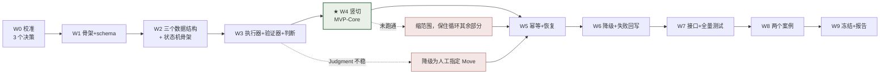

# R&D Roadmap to 2027-01-01 — 到 MVP 的研发路径

> 版本：2026-10-28 · 状态：**Current Plan**（替代 `docs/development/mvp-plan.md` §12 的批次时间化，**不替换** `docs/development/mvp-plan.md` 的工程内容）
> 目标：**2027-01-01 之前交付 WAM MVP**
> 上位：`docs/development/mvp-plan.md`（工程权威）· `docs/development/scope.md`（MVP 由格子推导）
> 本文档只回答两件事：**这 9 周每周做什么**、**做不成的条件是什么**。

---

## 0. 起点修正（必须先看）

`docs/development/mvp-plan.md` 写于 **2026-10-09**，今天是 **2026-10-28**。三处事实已经变了，其中一处推翻了原计划的技术选择。

| # | `docs/development/mvp-plan.md` 的说法 | 2026-10-28 实测 | 影响 |
|---|---|---|---|
| **R-1** | **codex-cli 0.138.0 作首个 JudgmentProvider + MoveExecutor**（B-09） | codex CLI 存在、**已登录**，但请求 `api.openai.com` 返回 **403 `Country, region, or territory not supported`**（cf-ray HKG）。即：**认证通过，网络地区受限** | **B-09 被证伪。** codex 不可作首选执行器，见 §4 决策 D1 |
| **R-2** | Python 3.13.12 | 本机为 **3.14.2** | 无实际影响（零第三方依赖）；但 `docs/decisions/register.md` X-09 需更新 |
| **R-3** | 计划留 12 周（到 2027-01-01 若有 12 周） | 实际剩 **9 周 3 天**（10-29 → 12-31，可工作 65 天） | 批次必须重排，且必须有明确砍单顺序（§6） |

**一条不必修正的**：`OPENAI_BASE_URL`（`new.sharedchat.cc`）历史上 403；本轮未能可靠复测（沙箱 curl 的 TLS 凭证被拒），因此**不把它当作可用也不当作不可用**，仅记为未验证。

---

## 1. 目标：MVP 的一句话定义

从 `docs/development/scope.md` §4 推导出来，不由讨论决定：

> **在 2026-12-31 之前，`wam run` 能在一个有真实代码的 fixture 项目上，完整走通一次「意图 → 局面 → 判断 → 调度 → 执行 → 证据 → 状态提交 → 再判断」，并满足：① 至少一次可被独立检查的真实产物变化；② 第二次判断的理由引用第一次的新证据；③ 每次 `Committed` 都能追到一份通过验收的证据；④ kill 后重启能恢复；⑤ 用户不看对话，只看 CLI 头部四行，就能回答"在做什么 / 为什么 / 在等谁 / 怎么解锁"。**

①–④ 来自 `docs/development/mvp-plan.md` §3.3；**⑤ 是本次新增**，来自 `docs/development/scope.md` U2（L4 呈现层）。

**MVP 类型声明**：只主张 **T1（收敛型）**，对 **T2** 的 L1–L2 层次有限支持（`docs/development/scope.md` §3.2）。T3/T4 是 Phase 4 的检验对象，不是 MVP 的承诺。

---

## 2. 时间数学（先说清，再说计划）

| 项 | 值 |
|---|---|
| 可用日历时间 | 2026-10-29 → 2026-12-31 = **9 周 2 天** |
| `docs/development/mvp-plan.md` 的 15 个任务，工程估算 | **90–150 小时**（每个 6–10h，按"从未跑过的设计"取上限） |
| 隐含的工作量假设 | **每周 12–16 小时**，无中断周 |
| 缓冲 | **没有独立缓冲周**。缓冲藏在每周的"不通则怎么办"里，不藏在日历末尾 |

> 如果实际投入低于每周 10 小时，这个计划会在 W4 断裂。**断裂点是 W4（竖切），不是 W9。** 所以 W4 的退出条件是全计划唯一不可谈判的门。

---

## 3. 九周计划

> 每周的"退出条件"全部是 **E1（一条命令能红/绿）**。没有 E2/E3 的退出条件出现在这张表里——那是 Phase 4 的事。
> "不通则"写的是**降级路径**，不是"再努力一点"。

| 周 | 日期 | 任务 | 退出条件（E1） | 不通则怎么办 |
|---|---|---|---|---|
| **W0** | 10-28 → 11-01 | **校准周**：本文件 · `docs/development/scope.md` · 三个决策（§4）· 装 `dsh --profile headless` 并跑通一次 | `dsh --profile headless "print ok"` 返回一次结果；三个决策各有记录 | 若 headless 不可用 → 直接走 §4 D1 的备选 B（人executor），**不因此延期** |
| **W1** | 11-02 → 11-08 | T-01 骨架 + T-02 `StateRepository` + **schema v1（含 `agent_state` 与 `scope`）** | `python -m unittest`：连写 100 次无损坏 / 写入中断后旧文件完整 / 损坏 JSON 不被覆盖 / save→load 一致 **4 条绿** | schema 是纯本地工作，无非技术失败。**若本周未完成，说明周投入不足，立即按 §6 砍** |
| **W2** | 11-09 → 11-15 | T-03 SituationBuilder + T-04 Intent/授权 + T-05 Move 四要素 + **U1 状态机骨架与六条不变量断言** | 无 source 的 fact 被拒 / `origin=inferred` 可区分 / `deny` 命中强制降为 `read-only` / 缺四要素停在 `Proposed` / **六条不变量各有 1 个测试** | 字段设计若明显不够，允许改字段，但 **不允许改循环顺序**（先有真实实现才知道字段对不对） |
| **W3** | 11-16 → 11-22 | T-06 `MoveExecutor`（§4 D1 的路线）+ T-07 `EvidenceVerifier`（3 类 criterion）+ T-08 `JudgmentProvider` + fixture 项目 | 在 fixture 跑一次真实执行 / 非零退出码返回 `ok=false` 而非异常 / 每类 criterion 各 1 测试 / 验证器抛错 → `insufficient` / **Judgment 连续 3 个不同输入都能通过 JSON 校验** | Judgment 若 3 次仍不稳定 → **停止调 prompt**，回到设计（OQ-21）。可先把 Judgment 降级为"人工指定 Move"，其余照跑 |
| **W4** | 11-23 → 11-29 | **T-09 竖切 ★ 唯一里程碑** + 头部四问渲染（U2） | `docs/development/mvp-plan.md` §3.3 判据 1–4 **全部满足**，其中判据 1 是硬性的：**产物真的变了，且能被独立检查** + `wam run` 第一屏输出四行 | **缩范围到「人工指定 Move」的半自动模式**，先把循环其余部分跑通（`docs/development/mvp-plan.md` §9.2 已授权此降级）。**不许把判据 1 解释成"生成了一份计划"** |
| **W5** | 11-30 → 12-06 | T-10 幂等 + 中断恢复 + A5/A6（真实 kill，不用 mock） | kill 后重启恢复 Active Move；`reversible:false` 的 Move **不自动重试**，转 `needs_human` | 幂等若无法可靠实现 → **停止后续接口工作**，先解决（不可靠的幂等比没有幂等更危险） |
| **W6** | 12-07 → 12-13 | T-11 三条降级路径 + T-12 失败回写 + **J6 停滞检测** + A3/A4/A7/A8/A9/A12 | 三条降级各能实际触发且都不产生虚假 `Committed`；同一失败 3 次时第 2 次起理由必须引用失败信息；**连续 3 个无新事实的 Move 触发转向** | 降级路径若只能靠 mock 触发，视为未完成 |
| **W7** | 12-14 → 12-20 | T-13 全量测试 + T-14 抽 6 接口 + T-15 假实现替换 + A1/A2/A10/A11 | `unittest` 全绿；抽取前后 `journal/` 序列逐字节相同；换掉 `JudgmentProvider` 为"永远 ask_human"后循环仍正确走到 `Blocked` | 若某接口无法被替换验证 → **它不是真边界，降为普通函数**（`docs/development/mvp-plan.md` §12.8 已定） |
| **W8** | 12-21 → 12-27 | **Phase 4 判断质量验证**：案例 #1（T1，有测试）+ 案例 #2（T4，无任何数字指标）+ 失败分析 | 两个案例各有一份完整记录（含失败项）；**案例 #2 的 Move 理由不来自任何分数**；失败模式写进 `docs/decisions/register.md` | 如果案例 #2 跑不动 → **如实记录"WAM 目前只在有指标时成立"**。这是结论，不是事故；但 MVP 的类型声明要相应缩小 |
| **W9** | 12-28 → 12-31 | 冻结 + **MVP 报告**（能做什么 / 不能做什么 / 证据在哪）+ 发布 + 更新 README/站点 | 报告里每个"能"都能指到 `journal/` 或测试；每个"不能"都指到未通过项 | 只有 4 天，**不许开新工作**。未完成的项写进 `docs/development/scope.md` 的 MVP-OUT，不写成"部分完成" |

### 3.1 关键路径



**只有 W4 是不可替换的。** W5–W9 的每一项都可以砍，砍掉的代价是 MVP 的"可靠性主张"变弱，而不是 MVP 不存在。

---

## 4. 三个决策（W0 内必须定）

### D1 — 谁来当 `JudgmentProvider` 与 `MoveExecutor`

| 选项 | 状态 | 优点 | 风险 |
|---|---|---|---|
| **A. `dsh --profile headless "<task>"`** | CLI 帮助文本实测存在（`answer one task, print the result, and exit`）；**profile 未安装**（`~/.dsh/profiles` 只有 `desktop`/`web`）；走已验证可用的 DeepSeek provider | 一个子进程就同时拿到「LLM + 工具 + 沙箱」；与仓库既有的 DSH preset 叙事一致；不需另配密钥 | 未实测；输出格式未确认可约束为 JSON；每次调用有启动开销 |
| **B. DeepSeek API 直连** | `DEEPSEEK_API_KEY` 在 DSH 凭据库中有引用；**未实测可否直接调用** | 延迟低、可控、易测 | 需自己实现工具调用层（重）；结构化输出能力未验证 |
| **C. 人作 `MoveExecutor`**（LLM 只做判断） | 零依赖 | **永远可用**；且它本身就是一个合法的 I4 实现（`docs/development/mvp-plan.md` §5.2 "人工执行 + 手工填证据"） | 吞吐低；不是"自主推进" |
| **X. codex-cli** | **已排除**：登录成功但 `api.openai.com` 403 地区限制 | — | — |

**建议**：**A 为主，C 为兜底，B 不作首选。** 判据是 W0 的一条命令：

```
dsh --profile headless "输出这一行 JSON：{\"ok\": true}"
```

- 返回里能取出 `{"ok": true}` → 选 A。
- 返回自然语言但**稳定** → 仍选 A，用「prompt 内要求 JSON + 我方校验 + 失败重试 1 次」代替 `--output-schema`。
- 失败或超 30 分钟调不通 → **选 C**，且**不认为这是失败**：MVP 的主张是"循环 + 证据 + 状态"，不是"全自主"。

**为什么这个决策必须在 W0 定**：它是 W3 的唯一外部依赖。晚定一周，W3 就变成"边等边设计"。

### D2 — `U1` 状态机是否进 MVP

**建议进（MVP-MIN）。** 理由与代价：

| | 内容 |
|---|---|
| 收益 | 它是 L4 层唯一的产出，直接服务 Continuity（`docs/development/scope.md` §1.1）；成本约 **1.5 天**（字段 + 迁移记录 + 6 条断言 + 4 行渲染） |
| 代价 | 10 个状态意味着 10 条测试；且状态一旦进了 schema，改动就是迁移 |
| 若不进 | MVP 仍然可交付，但"用户回来能不能接上"只能靠 E3 人工判断，无法自动化 → `docs/development/mvp-plan.md` §3.3 的判据 2（不重复旧任务）失去机器可判形式 |

**裁量线**：如果 W2 结束时 schema 已经定稿且状态机只差渲染，就进；如果 W2 拖到 11-18，**砍 U1 的状态机，只保留四行头部**（U2）。四行头部是硬的，状态机是软的。

### D3 — 共享上下文服务是否进 MVP

**建议不进。** 理由：MVP 只有 **1 个 agent**（D1 的任一选项都是单执行器），没有第二个读者/写者，scope 机制无从验证。它的正确归属是 `directions/shared-context/`（提案层）。

**但字段进**：`facts[].scope` / `assumptions[].scope` 以可选字段进 schema，默认 `project`。成本 1 行，收益是未来不必迁移已有事实。

---

## 5. 三条可能沉船的风险

| 风险 | 早期信号 | 缓解 | 若发生 |
|---|---|---|---|
| **S-1 又变成写文档** | W1 结束时没有 `.py` 文件 | 本文件与 `docs/development/scope.md` **之后不再写新文档**，直到 W4 跑通；任何新想法进 `directions/`，不进 `docs/` | 这是本仓库已发生 3 次（8-07→8-15→10-09→10-28）的模式。第 4 次发生时应视为**项目层面的结论**，而不只是又一周的延误 |
| **S-2 Judgment 是"看起来像判断的套话"** | W4 的输出读起来像模板；`why` 不引用 fact id | J2（`why` 必须引用具体 fact id）在 W4 就自动检查；W8 案例 #2 专门检验 | 这是"失败就是收获"的情形：写进 `docs/decisions/register.md`，判断机制按证据修订。**不许调 prompt 直到看起来好** |
| **S-3 无 LLM 可用** | D1 的 A/B 全不通 | C（人作 executor）永远可用 | MVP 的主张从"自主推进"降为"协作推进"，**这不是 MVP 的失败**，是环境的约束被如实记录 |

**三条以外的一条元风险**：这 9 周正好覆盖年底。历史上本项目的活动间隔是 8 天 → 8 周。**如果出现 2 周以上空档，本计划作废，按 §6 重排。**

---

## 6. 如果只剩 4 周（砍单顺序）

砍单顺序是**固定的**，不按偏好：

| 砍到 | 保留 | 得到什么 | 失去什么 |
|---|---|---|---|
| 第 1 刀 | W0–W4 | **MVP-Core**：一次真实闭环 + 四行头部 | 幂等、恢复、降级、接口、Phase 4 |
| 第 2 刀 | W0–W4 + W5 | MVP-Core 在中断后能恢复 | 失败回写、停滞检测 |
| 第 3 刀 | W0–W3 | 所有零件 + 一次真实执行，但没有闭环 | **这就是失败**（`docs/development/mvp-plan.md` §3.3：只生成计划/只写 JSON = 不通过） |

**第 3 刀不是 MVP。** 写在这里是为了让"还剩两周"时的选择是清醒的：要么缩到 MVP-Core，要么承认这一轮没有 MVP。**不存在"完成了 80%"这个选项**（`docs/development/scope.md` §0：不算完成度）。

---

## 7. 九周内明确不做

| 不做 | 理由 | 重新开的条件 |
|---|---|---|
| Dashboard / 图形界面（U4） | L4 的最小兑现是四行文字，不是面板 | MVP 跑通 + 有人真的每天看四行之外还想看更多 |
| 共享上下文服务（`directions/shared-context/`） | 单 agent 无共享需求 | 出现第二个真实 agent |
| 多 Agent 调度（M6 = G5） | 已拒绝，见 `directions/shared-context/` | 该方向的证伪实验给出反例 |
| 目标 DAG / 关键路径（S4） | H-04：依赖结构 ≠ 重要性 | 扁平的 `goals.md` 真实暴露检索痛点 |
| 四类场景全跑（T2/T3/T4 全量） | Phase 4 只跑 2 个案例 | W8 完成 |
| Sponge 集成（OQ-09） | 未裁决，且刻意不阻塞 MVP | 作者裁决后 |
| 意图修订历史（I4） | 尚未发生第一次真实修订 | 出现修订的那一刻 |
| 自动摘要 / 状态压缩（H-08） | 无正确性保证 | 有评价摘要正确性的方法 |

---

## 8. 2027-01-01 那天，什么算成功

三层定义，**只有第一层是承诺**：

| 层级 | 判据 | 兑现概率（我的判断） |
|---|---|---|
| **MVP-Core（承诺）** | 一次真实闭环 + 四行头部 + 至少一个案例的完整记录（含失败） | 中高——只要 W4 不断 |
| **MVP（期望）** | MVP-Core + 幂等/恢复 + 三条降级 + 6 接口可替换 + 2 个案例 | 中——取决于每周是否真有 12h |
| **MVP+（不承诺）** | 上述 + `Judgment` 在无数值指标下仍能形成有理由的下一步 | 低——这是 Phase 4 的结论，而 Phase 4 可能给出"不成立" |

**如果只做到 MVP-Core**，那也是一个真实的成果：它是这个仓库第一次有可运行的东西，而 `docs/development/mvp-plan.md` §14 自评里最致命的一条（"所有数据字段都是设计出来的，没跑过一次"）就结束了。

**如果 MVP+ 的结论是"不成立"**，那也是成果——它把 `docs/vision.md` §4.3 的核心假设（WAM 必须先回答 What matters 才能回答 What next）从信念变成有证据的判断。**这个项目已经花了 3 个月在没有证据的情况下相信它。**

---

## 9. 与 `docs/development/mvp-plan.md` 的关系（不替换）

| `docs/development/mvp-plan.md` 的内容 | 本文件如何处置 |
|---|---|
| §1 三个实现选择 | **R-1 修正**：执行器选择被环境证伪 → §4 D1 |
| §2 A/B/C 能力分类 | 保留。但 A/B/C 与 `docs/development/scope.md` 的 G 轴并行存在——前者按"实现难度"分，后者按"承诺强度"分，**不要合并** |
| §3 微型闭环与 4 条判据 | 保留，是 W4 的退出条件；**新增第 5 条判据（头部四问）** |
| §5 六个接口 | 保留。W7 抽出 |
| §6 `state.json` schema | 保留，**新增两个字段**：`agent_state`（`docs/architecture.md` §12.6）、`scope`（§4 D3） |
| §7 Move 生命周期 | 保留。与 Agent State 是**两个正交轴**，见 `docs/architecture.md` §12.1 |
| §8 15 个任务 | 保留，映射到 §3 的周 |
| §9 阶段门与 12 个验收用例 | 保留，映射到 W4–W7 的退出条件 |
| §12 批次计划（7 批次） | **被 §3 的九周表取代**（批次不变，时间化）。`docs/development/mvp-plan.md` §12 保留为历史记录，不再作为执行依据 |
| §13 待裁决清单 | 3 项阻塞里，**codex 登录已解决（但不可用）**；另 2 项转为 §4 的 D2/D3 |

---

## 10. 相关文档

| 需要 | 去看 |
|---|---|
| 工程细节（任务、接口、schema、验收用例） | `docs/development/mvp-plan.md` |
| 每个目标有多硬、凭什么算成立 | `docs/development/scope.md` |
| 状态机的完整定义 | `docs/architecture.md` §12 |
| 共享上下文与单 Agent 架构 | `directions/shared-context/README.md` |
| 外部可借鉴的工作与它们的取舍 | `research/external-assets.md` |
