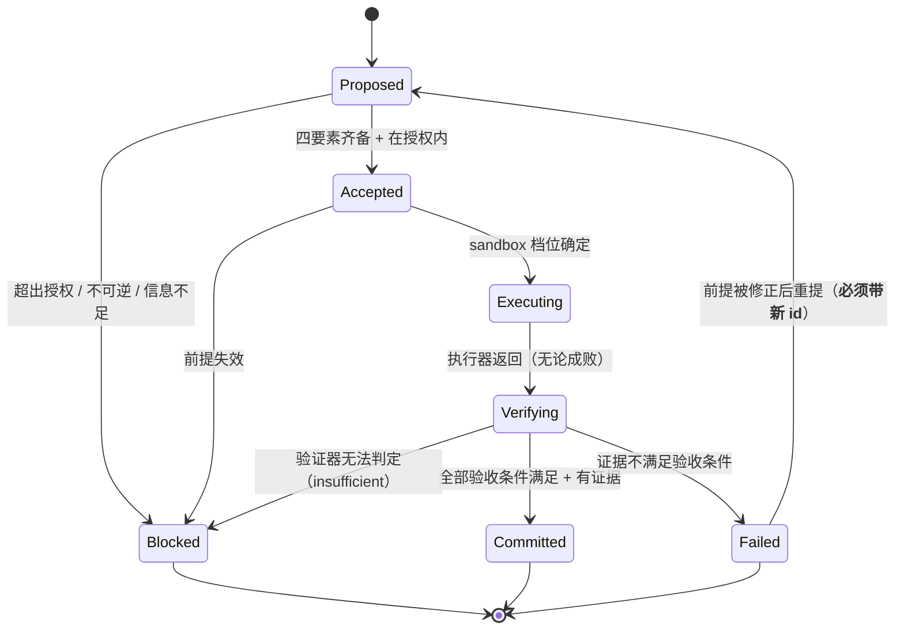

# Execution Contract — 接口、状态结构与 Move 生命周期

> Status: **specified**（未实现；`docs/decisions/register.md` 中无对应证据）· Version: 2026-11-10 · Supersedes: none（原文搬迁自**重构前**的 `docs/06-development-plan.md` §5–§7）
> Carrier: **none** — 本仓库尚无实现代码（`docs/development/roadmap.md` W1 起才有）
> 本文件是 2026-10-09 v3 版 `docs/06-development-plan.md`（今 `docs/development/mvp-plan.md`）的 §5–§7 **原文搬迁**：文字一字未改，**节号保留为 §5 / §6 / §7**，因此仓内原写作 `docs/06 §5.2` 的引用只需换路径，节号不变。
> 上游（为什么这样设计）：`docs/architecture.md` · 下游（哪一周实现它）：`docs/development/roadmap.md`

## 5. 接口与数据契约

### 5.1 三种状态必须区分

| 状态 | 含义 |
|---|---|
| **接口已定义** | 有契约（输入/输出/失败语义/调用方），但可以没有实现 |
| **接口已接入最小实现** | 循环真的在用它，且它真的能工作 |
| **高级能力已实现** | 更强的实现真的存在并被验证过 |

**禁止用"接口已定义"冒充"能力已具备"。** 下表逐项标注。

### 5.2 六个接口

> 这六个来自候选职责清单。**每一个都保留，是因为它对应一个具体的、已知的替换理由。** 不需要替换理由的，不设接口——直接写函数。

---

#### I1 `IntentProvider` — 提供当前有效的意图与约束

| 项 | 内容 |
|---|---|
| **解决的边界问题** | 意图从哪来。循环不能假设意图永远由同一句话给出 |
| **替换理由** | Human Absent Mode 需要意图来自**签过字的授权记录**，而不是一个现场的人。届时 Intent 的可信度级别不同（"人说过的" vs "记录下来的"） |
| **最小输入** | `project_root`, `state.json` 现状, （可选）`--intent` 文本 |
| **最小输出** | `Intent{raw, goals[], constraints[], authorization{allow,deny,require_approval_for,expires_at}}` |
| **调用方 / 实现方** | 调用方：循环。实现方：文件读取 + 文本解析 |
| **失败表达** | 无 intent 记录且未提供 `--intent` → `NoIntent`（不是"用默认目标"） |
| **当前是否真实实现** | ✅ 是 |
| **未来更强实现** | 从授权记录 / 外部 tracker 读取；支持意图修订历史 |

**关键设计**：`goals[].origin ∈ {user, inferred}`。**`inferred` 的目标绝不能被当作用户说的**（`docs/vision.md` §3.2）。这个字段是 C-04 的结构化落实。

---

#### I2 `SituationBuilder` — 从工作区构建当前 Situation

| 项 | 内容 |
|---|---|
| **解决的边界问题** | 判断的输入从哪来，且必须能区分"看到的"和"以为的" |
| **替换理由** | 现在是文件树 + git。将来要做真实观察（跑测试、看 CI、查外部 API），成本和风险都高一个量级 |
| **最小输入** | `project_root`, `state.json` 现状, `workspace/*.md`（若存在） |
| **最小输出** | `Situation{facts[{statement, source, observed_at}], assumptions[{statement, validation_method, status}], unknowns[{question, blocking}]}` |
| **调用方 / 实现方** | 调用方：循环。实现方：文件树 + `git status --porcelain` + 现有 md 全文读入 |
| **失败表达** | 项目根不存在 / 不是目录 → `NoProject`；读不到 `workspace/*.md` → 不算失败（可选输入） |
| **当前是否真实实现** | ✅ 是 |
| **未来更强实现** | 真实观察执行；上下文压缩；**但"事实必须带 source"这条约束永远不变** |

**关键设计**：三个强制字段——事实无 `source` 拒绝入库；假设无 `validation_method` 降级为"信念"并标注；未知无 `blocking` 无法参与优先级。**这是 OQ-03（防止假设误当事实）的最小结构性防护，不是完整解决方案。**

---

#### I3 `JudgmentProvider` — 形成判断

| 项 | 内容 |
|---|---|
| **解决的边界问题** | **WAM 最核心、最该被替换的一块。** 循环的其他部分都不应该知道判断是怎么产生的 |
| **替换理由** | MVP 是单次 LLM 调用；未来是候选比较 + 反事实推演 + 长期后果分析 + 自我校准。**这些全部发生在这一个接口后面，循环不改** |
| **最小输入** | `Intent`, `Situation`, `constraints`, 上一次 Move 的结果（若有） |
| **最小输出** | `Judgment{decision, why, confidence, most_likely_wrong_about, alternatives_considered[], move?{intent_ref, premises[], expected_change, acceptance[], risk, reversible, idempotency_key}}` |
| **调用方 / 实现方** | 调用方：循环（**不解析 LLM 内部结构，只读 schema 后的字段**）。实现方：`codex exec --output-schema` |
| **失败表达** | schema 校验失败 / 超时 / 空输出 → `JudgmentUnavailable`。**降级路径固定为：`Blocked` + 请求人类判断。不重试超过 1 次，不 fallback 到"随便挑一个任务"** |
| **当前是否真实实现** | ✅ 是（受限版） |
| **未来更强实现** | 多候选生成与比较；反事实评估；价值冲突检测；判断置信的自校准 |

**MVP Judgment vs Future Judgment 的分界**：

| | MVP Judgment | Future Judgment |
|---|---|---|
| 输入 | Intent + Situation + 约束 | + 历史判断的结果、实际后果 |
| 处理 | 选一个下一步 | 价值冲突处理、反事实推演、长期后果 |
| 输出 | 一个 Move 或一个"不做" | 同上，但带更完整的权衡记录 |
| 自我校准 | 无 | 有（判断命中率、被现实否定率） |
| **不做什么** | 不打分、不排序、不多轮辩论、不多 Agent 协商 | — |

**MVP 的成功标准不是"已经等于 Future Judgment"，而是：Judgment 作为循环中的一环真的有效，且未来替换它时循环不必重写。**

---

#### I4 `MoveExecutor` — 执行被授权的 Move

| 项 | 内容 |
|---|---|
| **解决的边界问题** | 执行是 WAM 之外的事。执行器可以换，边界不能变 |
| **替换理由** | codex 只是第一个实现。DSH preset、人、未来的多 Agent 编排都会替换它。**P4 的核心主张正在于此** |
| **最小输入** | `Move`, `sandbox_tier`（由 `authorization` 推导，不由调用方随意指定） |
| **最小输出** | `ExecutionResult{exit_code, events[], artifacts[], duration}` |
| **调用方 / 实现方** | 调用方：循环。实现方：`codex exec` 子进程 |
| **失败表达** | 非零退出码 → `ExecutionResult` 正常返回但 `ok=false`。**执行器失败不是异常，是结果** |
| **当前是否真实实现** | ✅ 是 |
| **未来更强实现** | DSH preset；人工执行 + 手工填证据；多执行器并行 |

**关键设计**：sandbox 档位**只能由 `authorization` 推导**。调用方不能传 `--dangerously-bypass-approvals-and-sandbox`。这条是 T8（授权边界）的实现点。

---

#### I5 `EvidenceVerifier` — 判断证据是否足以更新状态

| 项 | 内容 |
|---|---|
| **解决的边界问题** | **五级证据阶梯的第 3→4 级。** "执行器说成功"到"状态可以更新"之间必须有一道独立的闸 |
| **替换理由** | 现在的验证器只能跑命令 + 查文件。将来需要跑测试套件、做语义检查、要人签字。**这道闸不能省，但闸的实现可以换** |
| **最小输入** | `Move.acceptance[]`, `ExecutionResult` |
| **最小输出** | `Verdict{pass, per_criterion[{criterion, met, actual}], insufficient?, failed?}` |
| **调用方 / 实现方** | 调用方：循环。实现方：内建（进程退出码 / 文件路径存在 / 输出包含） |
| **失败表达** | 验证器自身抛错 → `insufficient`（**默认保守：不提交**） |
| **当前是否真实实现** | ✅ 是 |
| **未来更强实现** | 测试套件；语义验证；人工确认作为一类 criterion |

**关键设计**：验收条件在 Move `Accepted` 时**就已写定并持久化**，不是验证时现编。事后编的验收条件等于没有。

---

#### I6 `StateRepository` — 保存与恢复项目状态

| 项 | 内容 |
|---|---|
| **解决的边界问题** | 连续性的物理载体。谁拥有状态，决定了换执行器会不会丢状态（P4） |
| **替换理由** | 单文件 JSON 有明确上限（体积、并发写、查询）。将来可能需要快照链或事件日志。**但那是替换这个接口，不是重写循环** |
| **最小输入** | `project_root`, 读：`load()`；写：`save(state)`（原子） |
| **最小输出** | `State{version, intent, situation, active_move, history[], journal[]}` |
| **调用方 / 实现方** | 调用方：循环的**唯一写入点**。实现方：`tempfile` + `os.replace` |
| **失败表达** | 文件不存在且无 `--init` → `NoState`（**不是"建一个空的"**）；JSON 损坏 → `CorruptState`，**不覆盖**，要求人工处理 |
| **当前是否真实实现** | ✅ 是 |
| **未来更强实现** | 快照链；事件日志 + 投影；多项目 |

**关键设计**：**循环中只有 I6 一个写入点。** 这是 B5（一致性）的答案——不是加锁或加事务，是让只有一个地方能写。

### 5.3 刻意不设的接口

| 没设什么 | 为什么 |
|---|---|
| `DirectionProvider` | 方向是 Judgment 的输出，不是独立职责（B-04） |
| `WeightCalculator` | 依赖结构 ≠ 重要性（H-04）。设它就是在为 P2 让路 |
| `CandidateRanker` / `Scorer` | 直接违反 P2。排序是辅助信息，不是判断 |
| `EventBus` / `Pipeline` / `Coordinator` | 循环是一条直线，加事件总线就是把 `if` 换成了订阅 |
| `ReflectionService` | 自动反思/摘要有无正确性保证未知（`docs/specifications/state-and-evidence.md` §7）。在证明它可靠之前，它不能碰权威状态 |

---

## 6. 项目状态与证据的最小模型

### 6.1 存储布局

```
<project_root>/
  .wam/
    state.json          # 唯一权威，单文件，原子写
    journal/            # 证据产物：每次 State Update 一个 JSON 记录
      0001-<move_id>.json
  workspace/            # 可选，M0 约定的 md（只读为证据，不回写）
```

### 6.2 `state.json` 最小结构

```jsonc
{
  "version": 1,
  "intent": {
    "raw": "帮我继续推进这个项目",          // 用户原话，逐字，不改写
    "goals": [
      { "id": "g1", "statement": "…", "origin": "inferred", "confidence": "low" }
    ],
    "constraints": [
      { "id": "c1", "statement": "不破坏现有测试", "origin": "user" }
    ],
    "authorization": {
      "allow": ["read_files", "run_tests", "edit_files_under_project"],
      "deny": ["network", "credentials", "delete_outside_wam"],
      "require_approval_for": ["irreversible", "outside_project_root", "force_push"],
      "expires_at": null
    },
    "revised_at": null,
    "revision_history": []
  },
  "situation": {
    "observed_at": "2026-10-09T16:00:00Z",
    "facts": [
      { "id": "f1", "statement": "pytest 有 3 个测试失败",
        "source": "pytest run @ 2026-10-09", "observed_at": "…" }
    ],
    "assumptions": [
      { "id": "a1", "statement": "失败原因是依赖版本回退",
        "validation_method": "检查 lockfile 与上次提交差异", "status": "unverified" }
    ],
    "unknowns": [
      { "id": "u1", "question": "这个模块是否还需要保留",
        "blocking": true, "how_to_answer": "问作者" }
    ]
  },
  "active_move": {
    "id": "m0003",
    "state": "executing",                 // 见 §7
    "intent_ref": "g1",
    "why": "…",                           // 必填
    "premises": ["a1"],                   // 引用的假设/事实 id
    "expected_change": "3 个失败测试中至少 1 个变绿，且没有新失败",
    "acceptance": [
      { "kind": "command_exit", "spec": { "cmd": "pytest -q" }, "expect": 0 }
    ],
    "risk": "low",
    "reversible": true,
    "idempotency_key": "m0003:pytest-after-pin-dep",
    "executor": { "kind": "codex", "sandbox_tier": "workspace-write" },
    "execution": null,                    // 执行后填
    "evidence": [],
    "verdict": null,
    "started_at": "…",
    "committed_at": null
  },
  "history": [ { "id": "m0001", "…": "…" } ],
  "journal": [
    { "ts": "…", "kind": "state_update", "move_id": "m0003",
      "summary": "…", "evidence_refs": ["journal/0003-m0003.json"] }
  ]
}
```

### 6.3 事实 / 推断 / 假设 / 未验证 的区分方式

| 类别 | 位置 | 强制约束 | 谁能改写 |
|---|---|---|---|
| **事实** | `situation.facts[]` | 必须有 `source`；无 `source` 拒绝入库 | 任何新证据（追加新 fact，不改旧 fact） |
| **推断** | `judgment.why` / `most_likely_wrong_about` | 明确标为判断的一部分，**不进 facts** | — |
| **假设** | `situation.assumptions[]` | 必须有 `validation_method`；否则 `status` 只能是 `belief` | 验证后 `status` 变 `supported` / `refuted`。**升级为 fact 必须显式动作 + 证据引用** |
| **未验证的结论** | `journal[].summary` | 措辞上必须能看出是"这次做了什么"，不是"世界是怎样的" | — |

**关键规则**：不存在"沉默即正确"。假设不会因为时间过去而自动变成事实。

### 6.4 哪些必须持久化，哪些可以重建

| 内容 | 处置 | 理由 |
|---|---|---|
| 意图原话、目标、约束、授权边界 | **必须持久** | 无法从代码或文件树重建；且它是判断的锚点 |
| Situation 的事实 + source | **必须持久** | 事实的来源不可重建。**只存事实不存 source，等于把事实降级成断言** |
| 假设 + 验证方法 | **必须持久** | 丢了就变成信念（OQ-03） |
| Active Move 的验收条件 | **必须持久** | 事后编的验收条件等于没有（I5） |
| 幂等键 | **必须持久** | 中断后判断"能否重试"的唯一依据 |
| 已完成 Move 的历史 | **必须持久** | 防止重复劳动（T5） |
| 失败信息 | **必须持久** | 不持久则重复无效行动（`docs/specifications/state-and-evidence.md` §5.2） |
| 文件树 / git status | **可重建** | 每次现查，不存 |
| Situation 的"当前摘要" | **可重建** | 从 facts + assumptions + unknowns 推导，不单独存 |

### 6.5 事件日志 / 快照 / 关系图的取舍

| 机制 | MVP 决定 | 依据 |
|---|---|---|
| 事件日志（完整） | ❌ 不做 | `journal/` 保留**每次状态更新的记录**，但不做事件溯源。理由：完整事件日志的价值在需要重放时，而 MVP 不重放 |
| 快照 | ✅ 就是 `state.json` 本身 | 单文件即全量快照，无需多版本 |
| 关系图 | ❌ 不做 | `docs/architecture.md` §8.2：Project Graph 明确推迟 |
| git | ✅ 保留 | 状态文件本身在 git 里，天然有版本与 diff。**这是比自建事件日志更强的可追溯性** |

**结论：单文件 JSON + git 已经是 MVP 的正确答案。** 需要解决的是"更新一致"（答案：唯一写入点 + 原子替换），不是"机制数量"。

---

## 7. Move 生命周期

### 7.1 状态机

**权威定义在 `docs/specifications/state-and-evidence.md` §3.2。** 本节只定义 **MVP 激活的状态子集**，并说明与完整状态集的映射。



**与 `docs/specifications/state-and-evidence.md` 完整状态集的映射**：

| 本节 MVP 状态 | `docs/specifications/state-and-evidence.md` 对应 | 说明 |
|---|---|---|
| Proposed | `Proposed` | 一致 |
| Accepted | `Authorized` | 改名，强调"已接受且在授权内" |
| Executing | `Executing` | 一致 |
| Verifying | `Reported` + `Evidenced` | **MVP 合并**：不区分"执行器报告"和"拿到证据"，但**仍不合并 `Verifying` 与 `Committed`**——那道闸是 C-07 的核心 |
| Committed | `Accepted`（docs/specifications/state-and-evidence.md 中表示"验收通过"） | 改名以避免与"Move 被接受"混淆 |
| Failed | `Failed` + `Analyzed` | MVP 要求失败必须带分析信息才写 `Failed` |
| Blocked | `Dropped` / 转人类 | MVP 新增显式状态：不是放弃，是等人 |

### 7.2 工程约束（逐条回答）

| 问题 | 答案 |
|---|---|
| **什么条件下可以开始执行？** | 四要素齐备（`intent_ref` / `premises` / `expected_change` / `acceptance[]` 非空）+ `why` 非空 + sandbox 档位可从 `authorization` 推导。**缺一不可，缺则停在 `Proposed`** |
| **执行器报告成功后为什么还要验证？** | 因为 C-07：五级证据阶梯的第 2→3 级是本项目最容易失误的地方。`codex exec` 返回 0 只说明它完成了被要求的动作，不说明结果满足验收条件。这是 `T3` 验收针对的场景 |
| **验证失败时状态如何变化？** | `Verifying` → `Failed`，**并且 `situation` 必须更新**：新事实 + 被反证的假设（`status: refuted`）+ 缩小后的方案空间。不更新 = 下次 Judgment 的输入没变 = 重复无效行动 |
| **中断后如何知道 Move 执行到一半？** | `state.json` 里 `active_move.state == "executing"` 且 `execution == null` → **中断在执行中**。此时查 `idempotency_key`：见 §7.3 |
| **一个 Move 会不会被错误重复执行？** | 见 §7.3 的幂等规则 |
| **哪些动作允许自动执行？** | `authorization.allow` 内 + `risk: low` + `reversible: true` → 自动 |
| **哪些必须人类批准？** | `authorization.require_approval_for` 命中的（`irreversible` / `outside_project_root` / `force_push`）+ `risk: high`。**硬编码在代码里的路径/命令黑名单**：`~`、`.git`、`.ssh`、`.env`、`*_credentials*`、注册表、Windows 系统目录 |
| **如何避免验证失败或状态保存失败导致记录不一致？** | ①验证失败 → 不写成果，只写失败信息（**不删已有事实**）。②保存失败 → 原子写保证 `state.json` 要么是旧的完整版要么是新的完整版，**不存在半写状态**。③若 `os.replace` 失败，原文件仍在，下次启动可重试 |

### 7.3 幂等与非幂等操作

**规则**：

| `reversible` | `idempotency_key` | 中断后恢复时的动作 |
|---|---|---|
| `true` | 有 | ✅ 允许重试（显式记录这是第 N 次尝试） |
| `true` | 无 | ⚠️ **先检查当前状态判断能否重试**，检查不了就降级为不可重试 |
| `false` | 任意 | 🛑 **禁止自动重试**。`state.json` 中标记 `needs_human`，把实际执行到的位置作为证据交给人判断 |

**非幂等操作的例子（必须 `reversible: false`）**：删除、发布、推送、发送、发版、迁移、任何写到项目外的动作。

**`idempotency_key` 的生成规则**：`move_id + ":" + 动作的语义标识`。**不允许包含时间戳**（含时间戳则每次重试都是新 key，幂等检查失效）。
